# 🧪 Evaluación Heurística de Usabilidad (H1 - H10)

## 📌 Información General
* **Materia:** Interacción Hombre-Computadora (IHC)
* **Proyecto:** Súmate App
* **Modalidad:** Individual
* **Alumno:** Santos Castro Roberto Anjel
* **Flujo Evaluado:** Descubrimiento (`/explore`), Búsqueda y Filtrado (`/activities/search`), Detalle de la Actividad (`/activities/[id]`) y Gestión de Participación (`ConfirmJoinDialog` / `ConfirmLeaveDialog`).
* **Metodología:** 10 Heurísticas de Usabilidad de Jakob Nielsen con escala estándar de severidad (0 a 4).

---

## 척 Escala de Severidad de Nielsen
* **0 - No es un problema:** No afecta la usabilidad.
* **1 - Cosmético:** Problema superficial; resolver solo si sobra tiempo.
* **2 - Menor:** Causa fricción o molestia baja; baja prioridad de resolución.
* **3 - Mayor:** Dificulta notablemente la tarea del usuario; alta prioridad.
* **4 - Catastrófico:** Impide completar la tarea; imperativo solucionarlo.

---

## 📊 Matriz Resumen de Evaluación Heurística

| Heurística | Pantalla / Flujo | Estado | Hallazgo / Severidad | Solución / Comprobación |
| :--- | :--- | :---: | :---: | :--- |
| **H1: Visibilidad del estado del sistema** | Búsqueda (`/activities/search`) | **Corregida** | El botón de filtros no indicaba si había filtros activos. *(Sev: 2)* | Se añadió badge numérico dinámico y estilo activo en el header. |
| **H2: Correspondencia con el mundo real** | Detalle (`/activities/[id]`) | **Corregida** | El botón de cancelar participación decía *"Asistiré (Confirmado)"* en verde. *(Sev: 3)* | Se cambió a botón rojo explícito *"Cancelar participación"* con icono de retiro. |
| **H3: Control y libertad del usuario** | Detalle y Modales (`/activities/[id]`) | **Cumple** | N/A *(Sev: 0)* | Modales de confirmación con salida reversible ("Cancelar" / "Mantener mi lugar"). |
| **H4: Consistencia y estándares** | Catálogo y Detalle (`/explore`, `/activities/[id]`) | **Cumple** | N/A *(Sev: 0)* | Sistema de diseño shadcn/ui consistente, paleta cromática de estados e iconografía Lucide. |
| **H5: Prevención de errores** | Detalle de Actividad (`/activities/[id]`) | **Cumple** | N/A *(Sev: 0)* | Botón bloqueado con *"Cupos agotados"* y candado cuando la capacidad llega al límite. |
| **H6: Reconocimiento antes que recuerdo** | Tarjetas de Catálogo (`/explore`) | **Cumple** | N/A *(Sev: 0)* | Metadatos clave visibles directamente en la tarjeta (título, causa, fecha, hora, autor). |
| **H7: Flexibilidad y eficiencia de uso** | Búsqueda y Filtros (`/activities/search`) | **Cumple** | N/A *(Sev: 0)* | Presets de fecha rápida (Hoy, Mañana, Fin de semana), distancia relativa y búsqueda por texto. |
| **H8: Diseño estético y minimalista** | Catálogo de Actividades (`/explore`) | **Corregida** | Cupos disponibles en texto gris plano sin jerarquía visual. *(Sev: 2)* | Se rediseñó como píldora verde esmeralda destacada con icono visible. |
| **H9: Ayudar a reconocer y recuperarse de errores** | Búsqueda sin resultados (`/activities/search`) | **Corregida** | Estado vacío sin salida de acción directa para modificar criterios. *(Sev: 2)* | Se incorporó botón directo de acción *"Ajustar filtros"* que despliega el panel de filtros. |
| **H10: Ayuda y documentación** | Búsqueda y Formularios | **Cumple** | N/A *(Sev: 0)* | Placeholders descriptivos, tooltips y descripciones en cada campo y modal. |

---

## 🔎 Detalle de Evaluación Heurística (H1 a H10)

### H1: Visibilidad del estado del sistema
* **Estado:** **Corregida con evidencia**
* **Pantalla / Flujo:** Búsqueda y filtrado (`/activities/search`)
* **Problema:** Cuando el usuario aplicaba filtros (por causa temática, fecha o radio de distancia), el botón de filtros en el encabezado mantenía su aspecto habitual sin indicar visualmente cuántos filtros estaban activos. El usuario perdía visibilidad del estado de la búsqueda.
* **Severidad:** **2 (Menor)**
* **Solución y Comprobación:** Se condicionó el botón de filtros para que al detectar filtros activos (`activeFiltersCount > 0`) cambie al color primario (`bg-[#6355de]`) y renderice un badge numérico circular en rojo (`bg-rose-500`) con la cuenta de filtros aplicados.
* **Referencia de código:**
  - `client/src/features/activities/presentation/components/elements/activity-search-header.tsx:88-111`
  - `client/src/features/activities/presentation/components/views/activity-search-view.tsx:39`
* **Commit:** `c4ab2a6`
* **Evidencia:**

| Antes de la corrección | Después de la corrección |
| :---: | :---: |
| 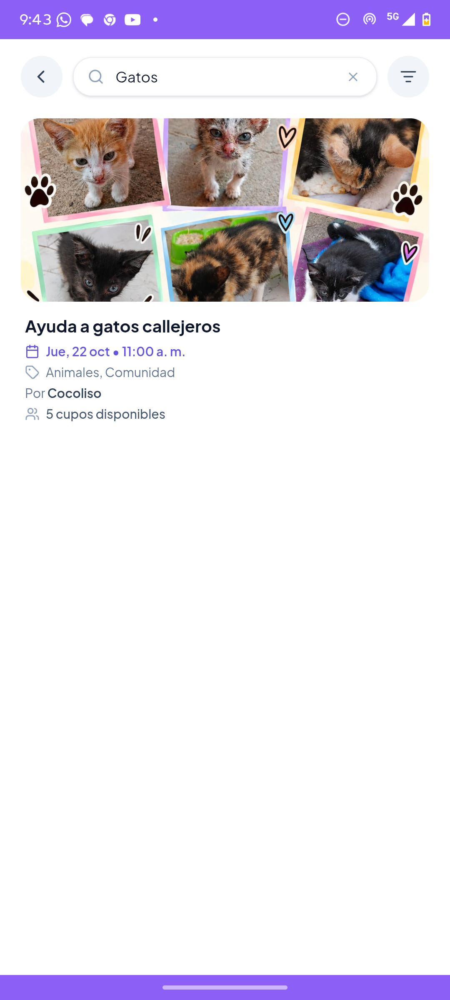 |  |

---

### H2: Correspondencia entre el sistema y el mundo real
* **Estado:** **Corregida con evidencia**
* **Pantalla / Flujo:** Detalle de actividad (`/activities/[id]`)
* **Problema:** Tras unirse a una actividad, el botón de acción principal cambiaba al texto *"Asistiré (Confirmado)"* en fondo verde esmeralda y un check. Parecía una etiqueta informativa estática y no un botón interactivo. Los voluntarios no sabían cómo cancelar su asistencia o pulsaban por error esperando ver su entrada.
* **Severidad:** **3 (Mayor)**
* **Solución y Comprobación:** Se aplicó afórdance directo: cuando el usuario está participando, el botón muestra de forma explícita la acción destructiva: `"Cancelar participación"` con icono de retiro (`UserMinus`) y color rojo peligro (`bg-rose-600`), abriendo el diálogo de confirmación correspondiente.
* **Referencia de código:**
  - `client/src/features/activities/presentation/components/elements/activity-detail-actions.tsx:180-190`
* **Commit:** `c4ab2a6`
* **Evidencia:**

| Antes de la corrección | Después de la corrección |
| :---: | :---: |
|  | 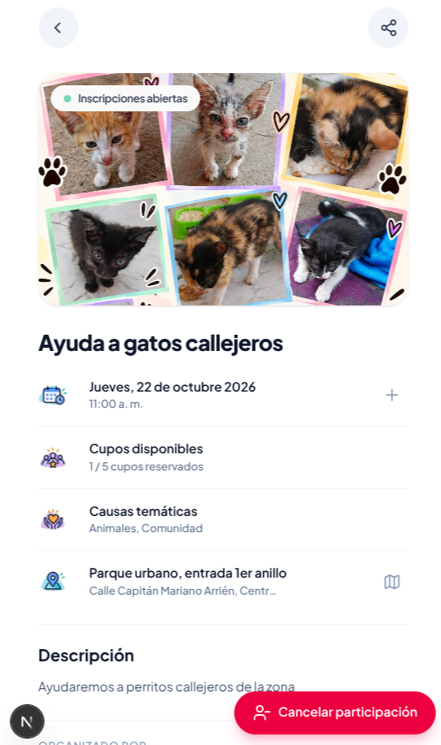 |

---

### H3: Control y libertad del usuario
* **Estado:** **Cumple**
* **Pantalla / Flujo:** Detalle de actividad y modales de confirmación (`/activities/[id]`)
* **Comprobación:** La aplicación ofrece salidas de emergencia claras y acciones reversibles en todo el flujo de participación:
  1. Si el usuario pulsa para participar, se abre un diálogo modal con la opción explícita de `"Cancelar"` sin registrar nada.
  2. Si el usuario desea retirarse, el diálogo de cancelación ofrece la opción de `"Mantener mi lugar"`.
  3. La participación es completamente reversible en cualquier momento mientras la actividad permanezca activa.
* **Referencia de código:**
  - `client/src/features/participations/presentation/components/dialogs/confirm-join-dialog.tsx:52`
  - `client/src/features/participations/presentation/components/dialogs/confirm-leave-dialog.tsx:52`
* **Evidencia:**

| Modal Confirmar Asistencia | Modal Cancelar Participación |
| :---: | :---: |
| 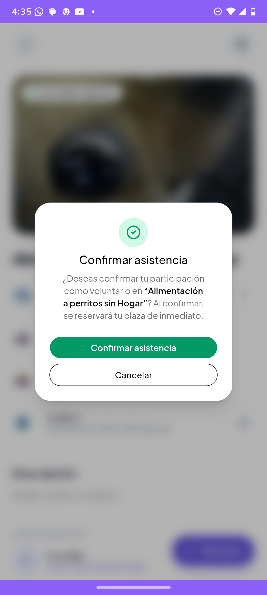 | 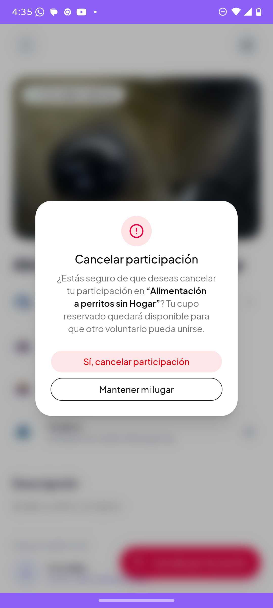 |

---

### H4: Consistencia y estándares
* **Estado:** **Cumple**
* **Pantalla / Flujo:** Todo el sistema (`/explore`, `/activities/[id]`, navegación)
* **Comprobación:** La aplicación sigue estándares web y móviles universales a través de componentes consistentes de shadcn/ui:
  1. Los estados manejan la misma semántica cromática en tarjetas y cabeceras: verde para activo/abierto, amarillo para borrador, gris para cerrado.
  2. La iconografía proviene de la librería estándar Lucide (`Calendar`, `MapPin`, `Users`, `Search`, `Tag`).
  3. Los encabezados poseen un botón de retroceso consistente en la esquina superior izquierda.
* **Referencia de código:**
  - `client/src/features/activities/presentation/components/elements/activity-card.tsx:16-36`
  - `client/src/features/activities/presentation/components/elements/activity-detail-hero.tsx:53-83`
* **Evidencia:**

| Catálogo / Cards | Detalle de Actividad | Navegación y Estados |
| :---: | :---: | :---: |
|  |  |  |

---

### H5: Prevención de errores
* **Estado:** **Cumple**
* **Pantalla / Flujo:** Detalle de actividad (`/activities/[id]`)
* **Comprobación:** El sistema previene proactivamente que un voluntario intente unirse a una actividad que ya no tiene espacio:
  1. Al alcanzar el cupo máximo (`isFull = participants >= capacity`), el botón interactivo se deshabilita automáticamente (`disabled`).
  2. Cambia su apariencia a gris tenue con icono de candado (`Lock`) y la etiqueta descriptiva *"Cupos agotados"*, eliminando cualquier posibilidad de error en la API o falsas expectativas.
* **Referencia de código:**
  - `client/src/features/activities/presentation/components/elements/activity-detail-actions.tsx:190-199`
* **Evidencia:**
  - 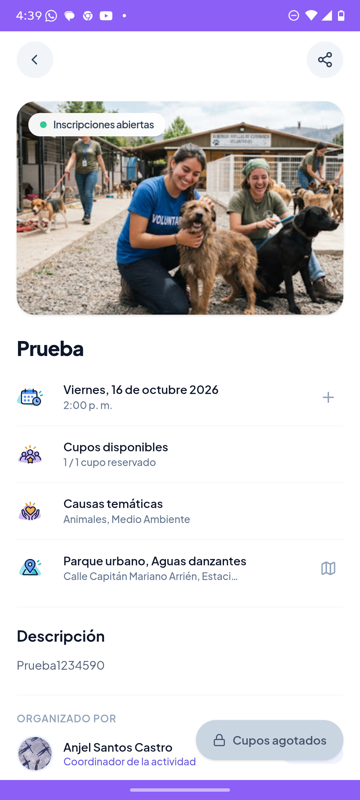

---

### H6: Reconocimiento antes que recuerdo
* **Estado:** **Cumple**
* **Pantalla / Flujo:** Catálogo de actividades (`/explore`) y vista de detalle
* **Comprobación:** La interfaz no obliga al usuario a recordar datos entre pantallas:
  1. Cada tarjeta de actividad expone directamente los elementos clave para tomar una decisión: fotografía representativa, título, organizador, causa temática, fecha formateada en lenguaje natural y cupos disponibles.
  2. No requiere entrar a cada evento solo para conocer cuándo o de qué temática es.
* **Referencia de código:**
  - `client/src/features/activities/presentation/components/elements/activity-card-shell.tsx:78-90`
  - `client/src/features/activities/presentation/components/elements/activity-card.tsx:48-75`
* **Evidencia:**
  - 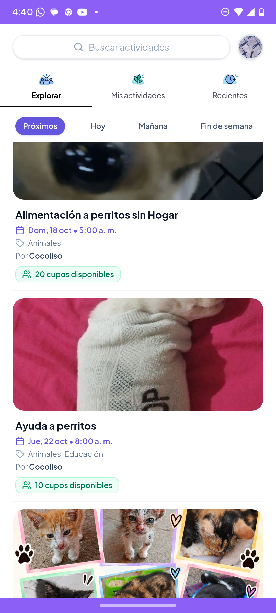

---

### H7: Flexibilidad y eficiencia de uso
* **Estado:** **Cumple**
* **Pantalla / Flujo:** Búsqueda y filtrado (`/activities/search`)
* **Comprobación:** El sistema se adapta tanto a usuarios que buscan una causa específica como a quienes buscan explorar oportunidades rápidas:
  1. Permite búsqueda textual inmediata con soporte de tecla Enter física y virtual móvil (`enterKeyHint="search"`).
  2. Ofrece presets rápidos en lenguaje natural (*"Hoy"*, *"Mañana"*, *"Este fin de semana"*).
  3. Permite filtrar por radio de proximidad geográfica en kilómetros alrededor del usuario.
* **Referencia de código:**
  - `client/src/features/activities/presentation/components/elements/activity-search-header.tsx:61-75`
  - `client/src/features/activities/presentation/components/elements/activity-search-filters-sheet.tsx:100-140`
* **Evidencia:**
  - 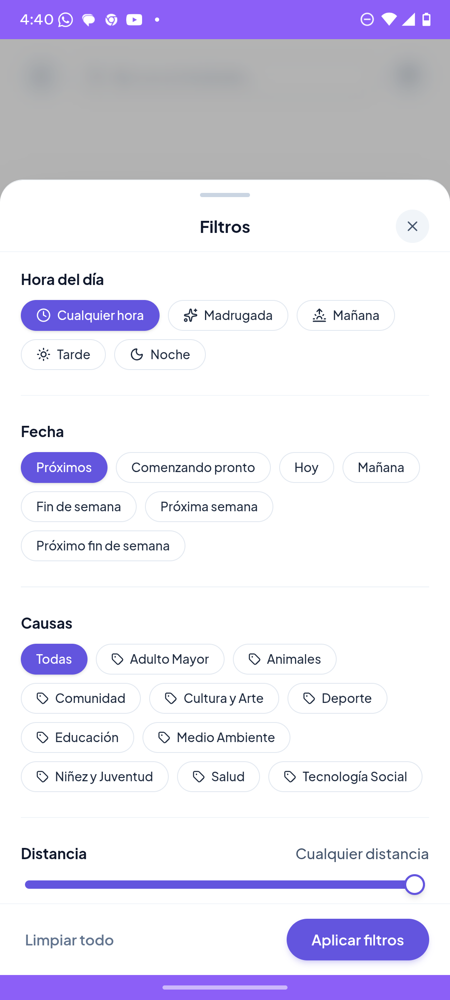

---

### H8: Diseño estético y minimalista
* **Estado:** **Corregida con evidencia**
* **Pantalla / Flujo:** Catálogo de actividades (`/explore` y `/activities/search`)
* **Problema:** En las tarjetas de actividad, la información de plazas disponibles se presentaba como texto gris indistinguible del resto de datos secundarios. Esto dificultaba escanear visualmente las convocatorias con aforo libre.
* **Severidad:** **2 (Menor)**
* **Solución y Comprobación:** Se rediseñó el conteo de aforo como una **píldora visual destacada** con fondo y borde verde esmeralda (`bg-emerald-50 text-emerald-700 border-emerald-200/80 font-semibold px-2.5 py-1 rounded-lg`) e icono de `Users`, resaltando la información clave sin sobrecargar la tarjeta.
* **Referencia de código:**
  - `client/src/features/activities/presentation/components/elements/activity-card.tsx:63-75`
* **Commit:** `c4ab2a6`
* **Evidencia:**

| Antes de la corrección | Después de la corrección |
| :---: | :---: |
| 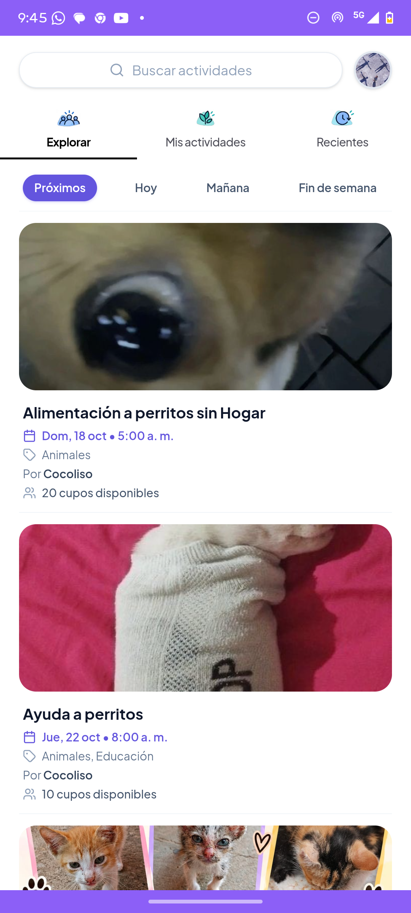 | 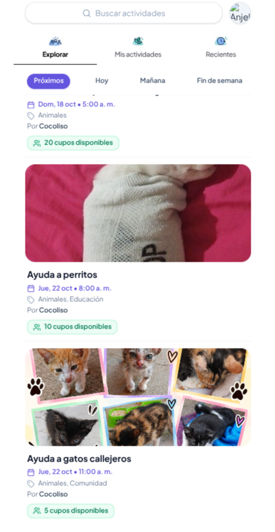 |

---

### H9: Ayudar a los usuarios a reconocer, diagnosticar y recuperarse de errores
* **Estado:** **Corregida con evidencia**
* **Pantalla / Flujo:** Búsqueda sin coincidencias (`/activities/search`)
* **Problema:** Cuando una búsqueda o combinación de filtros no arrojaba resultados, se mostraba el mensaje informativo *"Sin resultados"*, pero no se proporcionaba un camino de acción directo o recuperación inmediata en el cuerpo del estado vacío. El usuario tenía que buscar manualmente el icono de filtros en la esquina superior.
* **Severidad:** **2 (Menor)**
* **Solución y Comprobación:** Se implementó un botón de acción contextual sutil debajo del mensaje de sin resultados: `"Ajustar filtros"` con icono `SlidersHorizontal`. Al pulsarlo, abre de inmediato el panel inferior (bottom sheet) de filtros para que el usuario pueda calibrar o limpiar sus criterios de búsqueda con un solo toque.
* **Referencia de código:**
  - `client/src/features/activities/presentation/components/views/activity-search-view.tsx:90-99`
* **Commit:** `3311f23`
* **Evidencia:**

| Antes de la corrección | Después de la corrección |
| :---: | :---: |
| 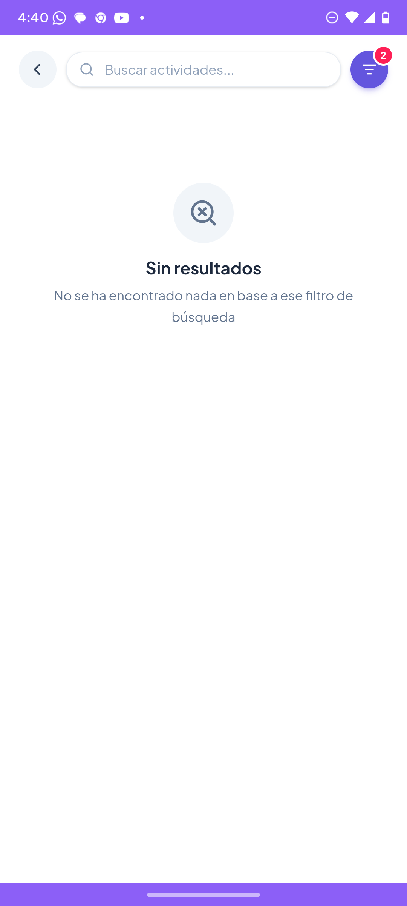 | 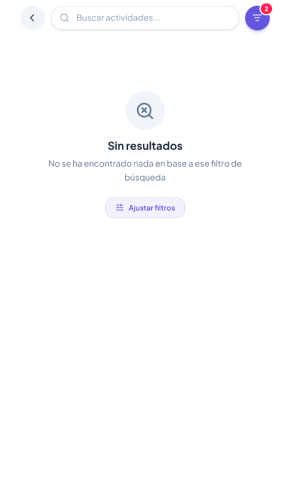 |

---

### H10: Ayuda y documentación
* **Estado:** **Cumple**
* **Pantalla / Flujo:** Búsqueda y modales de acción
* **Comprobación:** La aplicación ofrece micro-textos de ayuda contextual en los puntos de interacción:
  1. En el buscador se indica el placeholder descriptivo *"Buscar actividades..."*.
  2. En el diálogo de unirse se explica claramente la consecuencia de la acción: *"Al confirmar, se reservará tu plaza de inmediato."*
  3. En el diálogo de cancelación se detalla el impacto: *"Tu cupo reservado quedará disponible para que otro voluntario pueda unirse."*
* **Referencia de código:**
  - `client/src/features/activities/presentation/components/elements/activity-search-header.tsx:72`
  - `client/src/features/participations/presentation/components/dialogs/confirm-join-dialog.tsx:44-48`
  - `client/src/features/participations/presentation/components/dialogs/confirm-leave-dialog.tsx:44-48`
* **Evidencia:**
  - 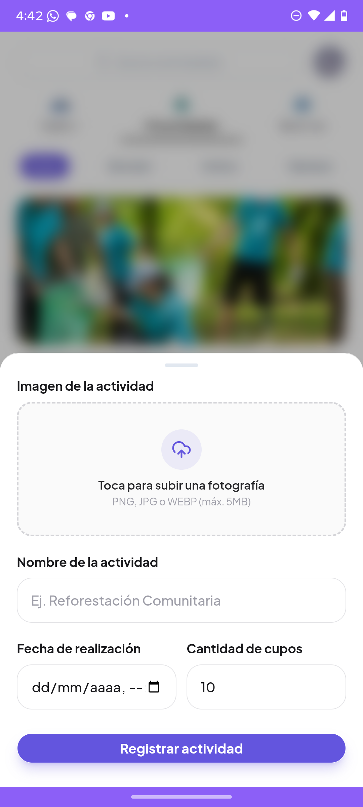
