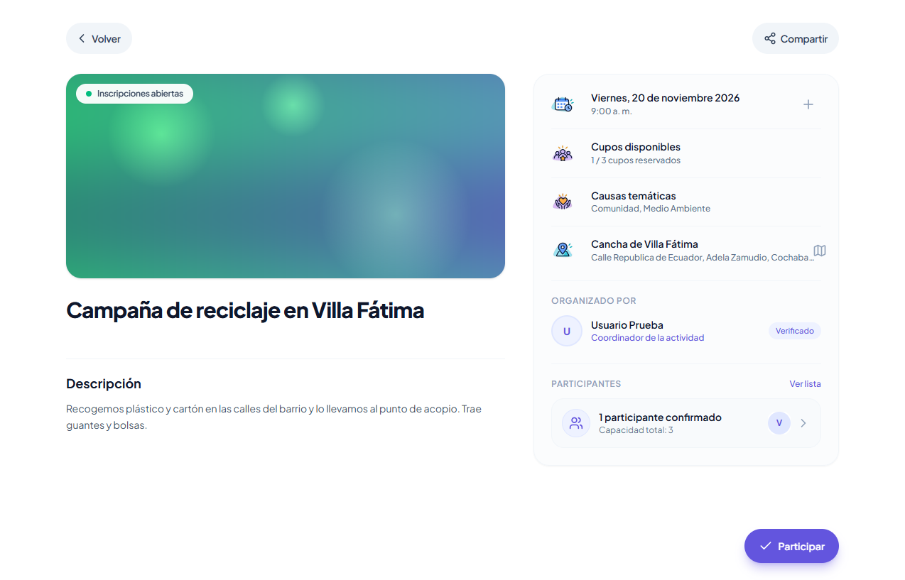
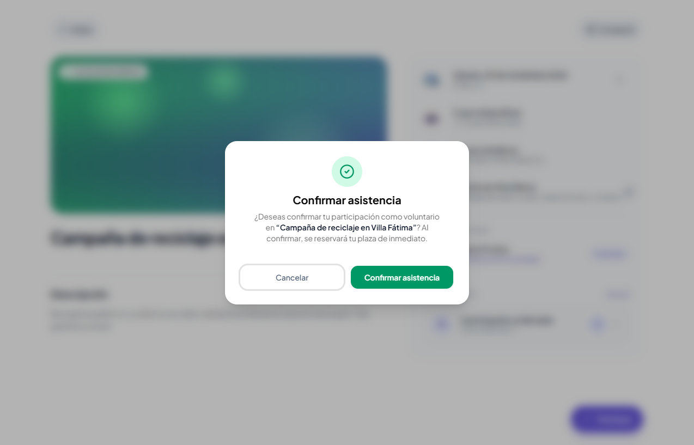
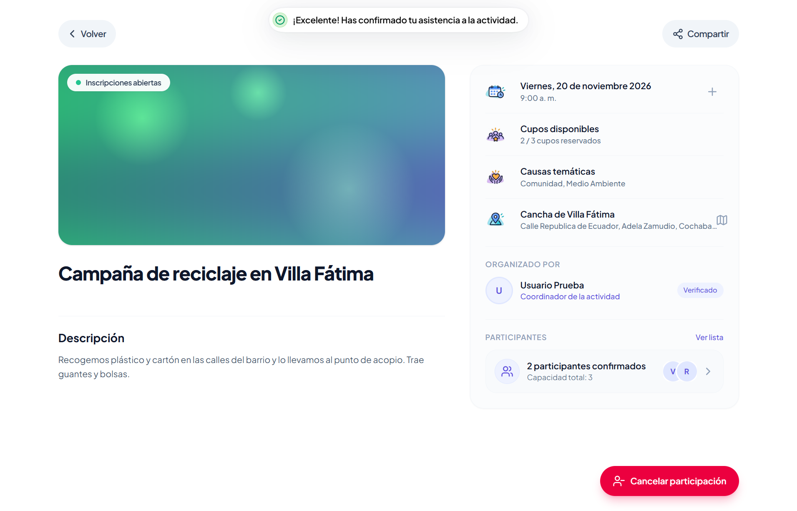

# Clase 17: análisis del proyecto recibido

## Proyecto recibido

Proyecto: Súmate App, plataforma para encontrar actividades de voluntariado y sumarse a ellas.  
Grupo anterior: Santos Castro Roberto Anjel (trabajo individual).  
Repositorio original: https://github.com/anjelradio/sumate-app  
Nuestro fork: https://github.com/Joabits/sumate-app  
Tecnologías: Next.js con Better Auth en `client`, FastAPI con SQLModel y PostgreSQL en `server`.

## Recorrido

Funcionalidad que seguimos: un voluntario participa en una actividad. Es la que cambia en la Tarea 5.

| Parte | Qué buscamos | Encontrado | Archivo |
|---|---|---|---|
| Pantalla | Dónde se muestra la actividad | `ActivityDetailView` con el botón Participar | [page.tsx](../../client/src/app/activities/%5Bid%5D/page.tsx#L40), [activity-detail-actions.tsx](../../client/src/features/activities/presentation/components/elements/activity-detail-actions.tsx#L206) |
| Acción | Qué función responde al clic | `handleConfirmJoin()` llama a `joinActivityAction()` y esta hace POST a `/api/participations/{id}` | [activity-detail-actions.tsx](../../client/src/features/activities/presentation/components/elements/activity-detail-actions.tsx#L57), [participation.action.ts](../../client/src/features/participations/presentation/actions/participation.action.ts#L8), [participation.repository.ts](../../client/src/features/participations/infrastructure/repositories/participation.repository.ts#L23), [participation_router.py](../../server/app/modules/participations/infrastructure/api/routers/participation_router.py#L71) |
| Regla | Dónde se valida la operación | `JoinActivityUseCase.execute()` | [join_activity.py](../../server/app/modules/participations/application/use_cases/join_activity.py#L41) |
| Datos | Dónde se guarda el resultado | `SQLModelParticipationRepository.save()` en la tabla `participations` | [sqlmodel_participation_repository.py](../../server/app/modules/participations/infrastructure/persistence/repositories/sqlmodel_participation_repository.py#L30), [participation_model.py](../../server/app/modules/participations/infrastructure/persistence/models/participation_model.py#L7) |

Pantalla: en el detalle de la actividad el voluntario toca Participar y se abre `ConfirmJoinDialog` para confirmar.  
Acción: al confirmar se ejecuta `handleConfirmJoin()`. La acción del servidor envía el pedido al backend con el token del usuario y después refresca el detalle, Explorar y Mi trayectoria.  
Regla: el caso de uso no deja unirse a la propia actividad, ni a una que no está activa, ni a una con fecha pasada, ni dos veces, ni cuando ya no hay cupos.  
Datos: si todo está bien se crea una `Participation` y se guarda una fila con `activity_id` y `user_id`. La tabla no permite repetir la misma pareja.

## Ejecución

Base de datos (Docker):

```
docker run -d --name sumate-db -e POSTGRES_PASSWORD=postgres -e POSTGRES_DB=sumate -p 5435:5432 postgres:16
docker exec -i sumate-db psql -U postgres -d sumate < client/better-auth_migrations/2026-10-01T20-04-26.141Z.sql
```

Backend, dentro de `server` (en `.env` va `DATABASE_URL` apuntando a la misma base):

```
python -m venv venv
venv\Scripts\pip install -r requirements.txt
venv\Scripts\alembic upgrade head
venv\Scripts\python scripts/seed_causes.py
venv\Scripts\python -m uvicorn main:app --reload --port 8000
```

Frontend, dentro de `client` (en `.env` van `DATABASE_URL`, `BETTER_AUTH_SECRET`, `BETTER_AUTH_URL` y `NEXT_PUBLIC_BACKEND_URL`):

```
pnpm install
pnpm dev
```

La app queda en http://localhost:3000 y la API en http://localhost:8000/docs.

Detalle de la actividad antes de participar:



Confirmación. El texto dice que la plaza se reserva de inmediato:



Después de confirmar el contador pasa de 1 a 2 participantes y aparece Cancelar participación:



## Impacto para la Tarea 5

Requisito: el voluntario solicita participar y la organización acepta o rechaza la solicitud. El resultado debe quedar guardado.

Hoy la participación se confirma en el mismo momento en que el voluntario toca Participar. No existe un estado intermedio ni una forma de que el organizador decida.

Datos: agregar a `participations` un estado (pendiente, aceptada, rechazada) con una migración nueva de Alembic. Las filas que ya existen pasan como aceptadas. [participation_model.py](../../server/app/modules/participations/infrastructure/persistence/models/participation_model.py#L7)  
Regla: `JoinActivityUseCase` debe crear la solicitud como pendiente. Hacen falta dos casos de uso nuevos, aceptar y rechazar, que solo pueda usar el organizador. Al aceptar se revisan los cupos contando solo las aceptadas. [join_activity.py](../../server/app/modules/participations/application/use_cases/join_activity.py#L68)  
Acción: dos rutas nuevas en [participation_router.py](../../server/app/modules/participations/infrastructure/api/routers/participation_router.py) y sus acciones en [participation.action.ts](../../client/src/features/participations/presentation/actions/participation.action.ts).  
Pantalla: el voluntario ve Solicitar participar y después "Solicitud pendiente" o "Solicitud rechazada". El diálogo ya no puede decir que la plaza se reserva de inmediato. El organizador ve las solicitudes pendientes con Aceptar y Rechazar en la lista de participantes. [activity-detail-actions.tsx](../../client/src/features/activities/presentation/components/elements/activity-detail-actions.tsx#L206), [confirm-join-dialog.tsx](../../client/src/features/participations/presentation/components/dialogs/confirm-join-dialog.tsx), [activity-detail-participants.tsx](../../client/src/features/activities/presentation/components/elements/activity-detail-participants.tsx)  
Conteos: todo lo que cuenta inscritos debe contar solo las aceptadas. Hoy se cuenta en varios lugares: [count_by_activity_id](../../server/app/modules/participations/infrastructure/persistence/repositories/sqlmodel_participation_repository.py#L54), [list_participants_by_activity_id](../../server/app/modules/participations/infrastructure/persistence/repositories/sqlmodel_participation_repository.py#L112), tres consultas iguales en [sqlmodel_activity_repository.py](../../server/app/modules/activities/infrastructure/persistence/repositories/sqlmodel_activity_repository.py#L126) (líneas 126, 175 y 330) y `isFull` en [activity-detail-actions.tsx](../../client/src/features/activities/presentation/components/elements/activity-detail-actions.tsx#L52).

Antes de agregar la funcionalidad conviene refactorizar esas tres consultas iguales en una sola función que diga qué cuenta como participación confirmada. Así la Tarea 5 cambia la regla en un solo lugar. Para comprobar que el refactoring no cambia nada corremos las pruebas del backend antes y después (`venv\Scripts\python -m pytest`, hoy pasan 60).
