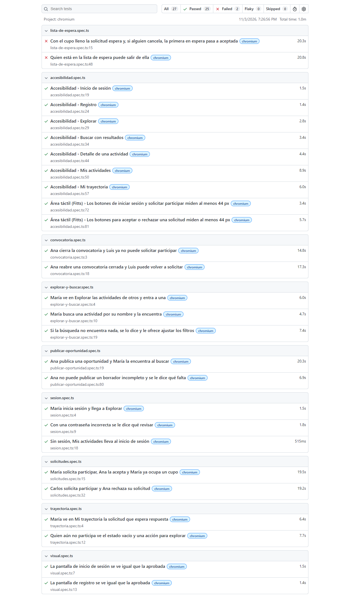
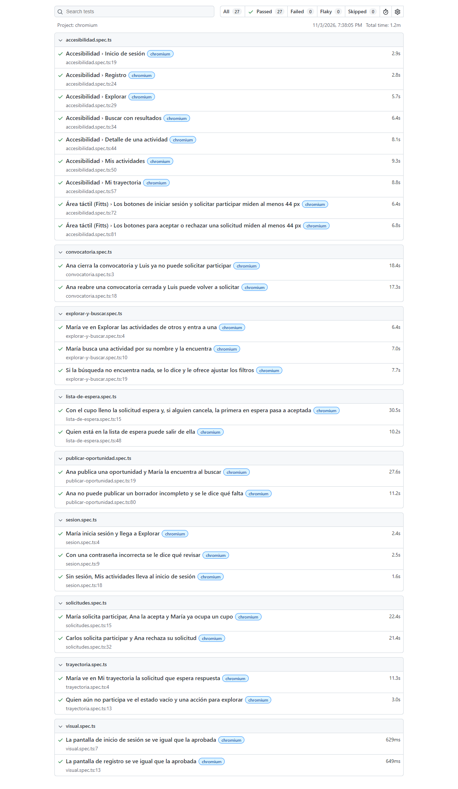
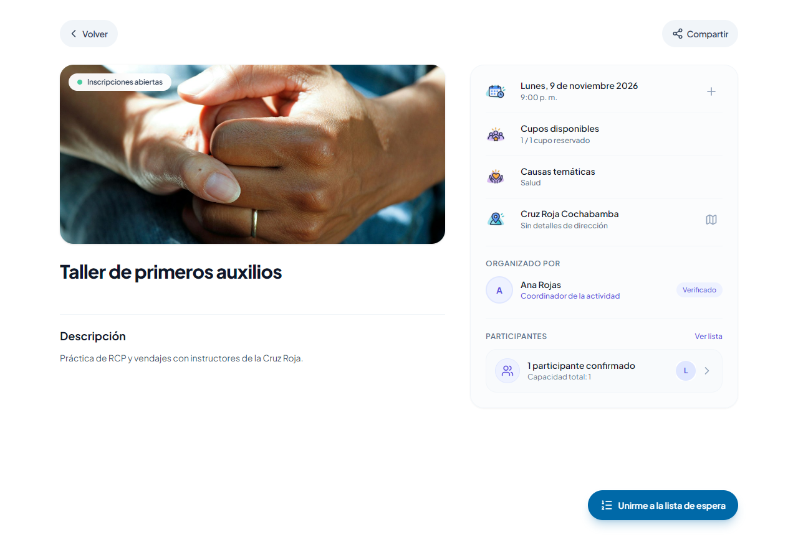
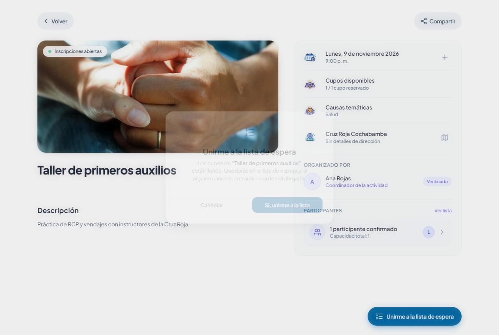
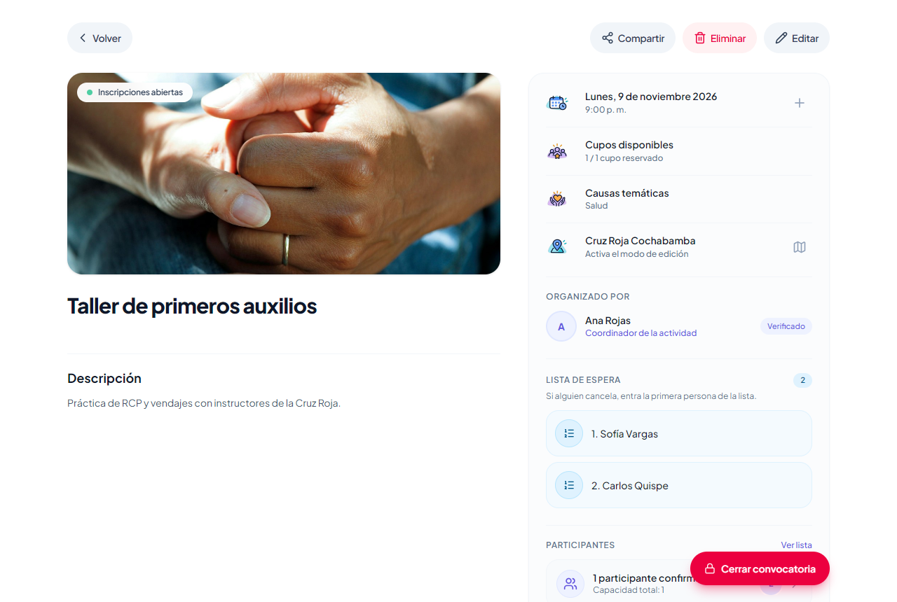
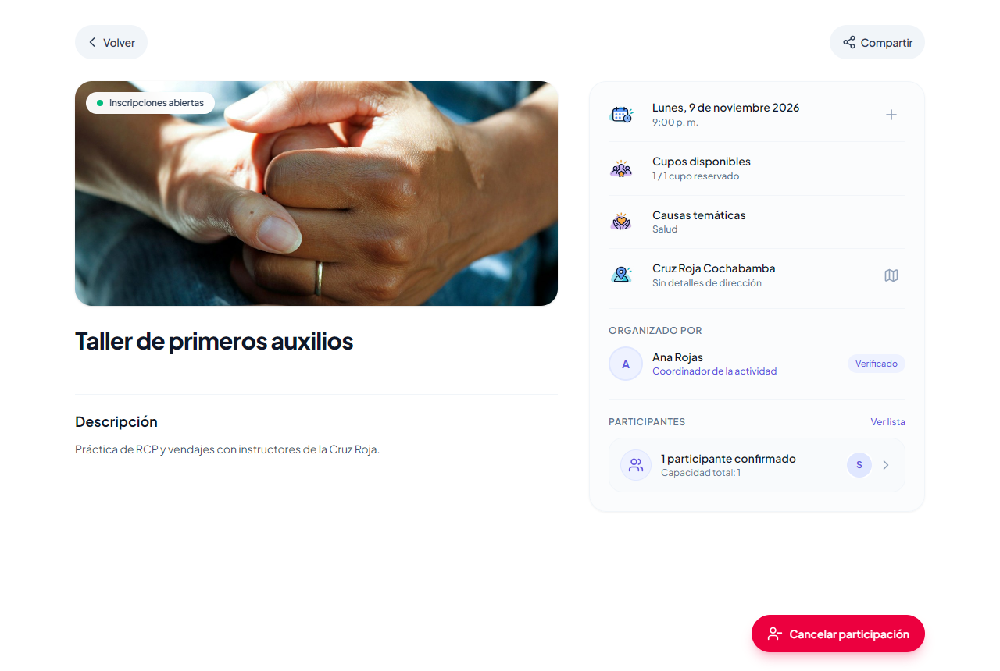
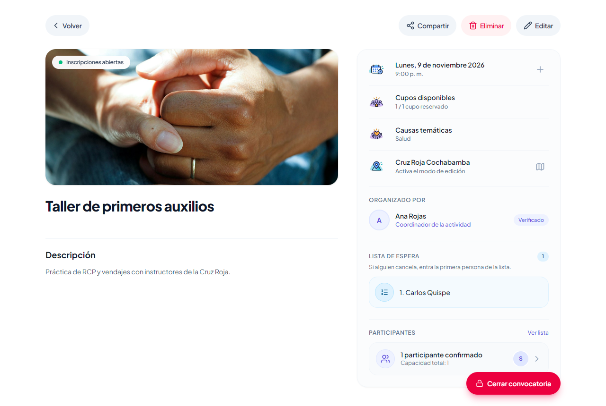

# Tarea 6: pruebas E2E y lista de espera

Fork: https://github.com/Joabits/sumate-app  
Pruebas: Playwright con Google Chrome y axe para accesibilidad, en [client/tests](../../client/tests).  
Feature: lista de espera. Cada oportunidad tiene sus cupos; si está llena, la solicitud espera; si alguien cancela, entra el primero.

## Cómo correrlas

Semilla: un solo comando dentro de `server`. Carga las causas, crea los usuarios de prueba si faltan y deja sus actividades como al principio. No toca a otros usuarios.

```
python scripts/seed_pruebas.py
```

Pruebas, dentro de `client` con la app levantada:

```
pnpm exec playwright test
pnpm exec playwright test --headed
pnpm exec playwright test lista-de-espera
```

Usuarios de prueba: están en el README, la contraseña de todos es `Demo12345`.  
Desde cero: Playwright corre la semilla antes de cada corrida ([semilla.ts](../../client/tests/semilla.ts)), así todas las corridas parten de los mismos datos. Después de la feature corrimos la suite dos veces seguidas y pasaron las 27 las dos veces.

## Matriz

Antes: la suite completa sin la lista de espera.  
Después: la misma suite con la lista de espera terminada.

| Flujo | Prueba | Camino | Comprueba | Antes | Después |
|---|---|---|---|---|---|
| Iniciar sesión | María inicia sesión y llega a Explorar | Feliz | Éxito | Pasa | Pasa |
| Iniciar sesión | Con una contraseña incorrecta se le dice qué revisar | Alternativo | Error | Pasa | Pasa |
| Iniciar sesión | Sin sesión, Mis actividades lleva al inicio de sesión | Alternativo | Permiso | Pasa | Pasa |
| Explorar | María ve en Explorar las actividades de otros y entra a una | Feliz | Relación | Pasa | Pasa |
| Buscar | María busca una actividad por su nombre y la encuentra | Feliz | Éxito | Pasa | Pasa |
| Buscar | Si la búsqueda no encuentra nada, se lo dice y le ofrece ajustar los filtros | Alternativo | Vacío | Pasa | Pasa |
| Publicar oportunidad | Ana publica una oportunidad y María la encuentra al buscar | Feliz | Éxito, persistencia, relación | Pasa | Pasa |
| Publicar oportunidad | Ana no puede publicar un borrador incompleto y se le dice qué falta | Alternativo | Error, persistencia | Pasa | Pasa |
| Solicitar participar | María solicita participar, Ana la acepta y María ya ocupa un cupo | Feliz | Éxito, relación, persistencia | Pasa | Pasa |
| Solicitar participar | Carlos solicita participar y Ana rechaza su solicitud | Alternativo | Relación, persistencia | Pasa | Pasa |
| Convocatoria | Ana cierra la convocatoria y Luis ya no puede solicitar participar | Feliz | Éxito, relación | Pasa | Pasa |
| Convocatoria | Ana reabre una convocatoria cerrada y Luis puede volver a solicitar | Alternativo | Éxito, relación | Pasa | Pasa |
| Mi trayectoria | María ve en Mi trayectoria la solicitud que espera respuesta | Feliz | Persistencia | Pasa | Pasa |
| Mi trayectoria | Quien aún no participa ve el estado vacío y una acción para explorar | Alternativo | Vacío | Pasa | Pasa |
| Lista de espera | Con el cupo lleno la solicitud espera y, si alguien cancela, la primera en espera pasa a aceptada | Feliz | Éxito, relación, persistencia | Falla | Pasa |
| Lista de espera | Quien está en la lista de espera puede salir de ella | Alternativo | Éxito, persistencia | Falla | Pasa |
| Accesibilidad | Inicio de sesión | axe WCAG 2 A y AA | Sin violaciones | Pasa | Pasa |
| Accesibilidad | Registro | axe WCAG 2 A y AA | Sin violaciones | Pasa | Pasa |
| Accesibilidad | Explorar | axe WCAG 2 A y AA | Sin violaciones | Pasa | Pasa |
| Accesibilidad | Buscar con resultados | axe WCAG 2 A y AA | Sin violaciones | Pasa | Pasa |
| Accesibilidad | Detalle de una actividad | axe WCAG 2 A y AA | Sin violaciones | Pasa | Pasa |
| Accesibilidad | Mis actividades | axe WCAG 2 A y AA | Sin violaciones | Pasa | Pasa |
| Accesibilidad | Mi trayectoria | axe WCAG 2 A y AA | Sin violaciones | Pasa | Pasa |
| Fitts | Los botones de iniciar sesión y solicitar participar miden al menos 44 px | boundingBox() | Área táctil | Pasa | Pasa |
| Fitts | Los botones para aceptar o rechazar una solicitud miden al menos 44 px | boundingBox() | Área táctil | Pasa | Pasa |
| Visual | La pantalla de inicio de sesión se ve igual que la aprobada | toHaveScreenshot() | Consistencia | Pasa | Pasa |
| Visual | La pantalla de registro se ve igual que la aprobada | toHaveScreenshot() | Consistencia | Pasa | Pasa |

Antes: 25 pasan y 2 fallan. Fallan las dos de lista de espera porque la feature no existía: Buscar escondía las actividades llenas y el botón decía Cupos agotados, sin forma de esperar.  
Después: 27 pasan, en dos corridas seguidas desde la semilla.

Reporte de Playwright antes de la feature:



Reporte después de la feature:



## Lo que encontraron las pruebas

En estos casos no se cambió la prueba, se arregló la interfaz.

| Prueba | Encontró | Arreglo en la app |
|---|---|---|
| `getByLabel('Nombre o referencia del lugar')` | Etiqueta sin asociar al campo | `htmlFor` + `id` en [location-map-sheet.tsx](../../client/src/features/activities/presentation/components/dialogs/location-map-sheet.tsx#L251) |
| `getByRole('link', { name })` | La tarjeta de actividad no tenía nombre accesible | `aria-label` con el nombre en [activity-card-shell.tsx](../../client/src/features/activities/presentation/components/elements/activity-card-shell.tsx#L61) |
| axe en todas las pantallas | El zoom estaba bloqueado (`maximum-scale=1`, `user-scalable=no`) | Se quitó del viewport en [layout.tsx](../../client/src/app/layout.tsx#L8) |
| axe en Explorar, Mis actividades y Mi trayectoria | Buscador del encabezado y pie de la barra lateral con contraste 2.5:1 | `text-slate-500` en [app-header.tsx](../../client/src/features/shared/presentation/components/layout/app-header.tsx#L54) y [desktop-sidebar.tsx](../../client/src/features/shared/presentation/components/layout/desktop-sidebar.tsx#L65) |
| axe en el detalle | Títulos Organizado por y Participantes con contraste 2.6:1 | `text-slate-500` en [activity-detail-organizer.tsx](../../client/src/features/activities/presentation/components/elements/activity-detail-organizer.tsx#L20) y [activity-detail-participants.tsx](../../client/src/features/activities/presentation/components/elements/activity-detail-participants.tsx#L26) |
| axe en Registro | Texto de términos y privacidad con contraste 2.6:1 | `text-zinc-500` en [signup/page.tsx](../../client/src/app/auth/signup/page.tsx#L24) |
| `boundingBox()` Fitts | Botones Aceptar y Rechazar de 36 px | 44 px en [solicitudes-pendientes.tsx](../../client/src/features/activities/presentation/components/elements/solicitudes-pendientes.tsx#L122) |
| Estado vacío de Mi trayectoria | Mensaje sin acción | Enlace Explorar actividades en [recently-feed.tsx](../../client/src/features/participations/presentation/components/elements/recently-feed.tsx#L57) |

## Feature: lista de espera

Cupos: solo cuentan las solicitudes aceptadas, igual que en la Tarea 5.  
Llena: si ya no hay cupos, la solicitud entra a la lista de espera en lugar de rechazarse.  
Orden: la lista sigue el orden de llegada.  
Si alguien cancela: entra el primero en espera y queda aceptado, sin que la organizadora haga nada.  
Si la organizadora agrega cupos: entran los primeros de la lista hasta llenarlos.  
Salir: quien espera puede salir de la lista; no entra nadie porque no se liberó un cupo.  
Buscar: la actividad llena sigue apareciendo, si no nadie podría unirse a la lista.  
Al mismo tiempo: al cancelar se bloquea la actividad con `FOR UPDATE`, así dos personas no toman el mismo cupo.

| Parte | Cambio | Archivo |
|---|---|---|
| Datos | Nuevo estado `en_espera`. La columna ya era texto, no hizo falta migración | [participation.py](../../server/app/modules/participations/domain/entities/participation.py#L16) |
| Regla | Con los cupos llenos la solicitud nace en espera | [join_activity.py](../../server/app/modules/participations/application/use_cases/join_activity.py#L82) |
| Regla | Al liberarse un cupo entra el primero en espera | [lista_de_espera.py](../../server/app/modules/participations/application/use_cases/lista_de_espera.py#L8) |
| Regla | Se usa al cancelar un aceptado y al agregar cupos | [leave_activity.py](../../server/app/modules/participations/application/use_cases/leave_activity.py#L72), [update_activity_capacity.py](../../server/app/modules/activities/application/use_cases/update_activity_capacity.py#L59) |
| Consulta | Lista de espera en orden de llegada | [sqlmodel_participation_repository.py](../../server/app/modules/participations/infrastructure/persistence/repositories/sqlmodel_participation_repository.py#L69) |
| Consulta | Puesto del voluntario y lista completa solo para la organizadora | [get_activity_detail.py](../../server/app/modules/activities/application/queries/get_activity_detail.py#L118) |
| Consulta | Buscar ya no esconde las actividades llenas | [sqlmodel_activity_repository.py](../../server/app/modules/activities/infrastructure/persistence/repositories/sqlmodel_activity_repository.py#L143) |
| Pantalla | Botones Unirme a la lista de espera y En lista de espera, puesto N | [activity-detail-actions.tsx](../../client/src/features/activities/presentation/components/elements/activity-detail-actions.tsx#L224) |
| Pantalla | Confirmación al unirse y al salir | [confirm-join-dialog.tsx](../../client/src/features/participations/presentation/components/dialogs/confirm-join-dialog.tsx#L34), [confirm-leave-dialog.tsx](../../client/src/features/participations/presentation/components/dialogs/confirm-leave-dialog.tsx#L57) |
| Pantalla | La organizadora ve la lista en orden | [lista-de-espera.tsx](../../client/src/features/activities/presentation/components/elements/lista-de-espera.tsx#L36) |
| Pantalla | Mi trayectoria muestra En lista de espera | [recently-feed.tsx](../../client/src/features/participations/presentation/components/elements/recently-feed.tsx#L85) |

Pruebas del backend: 8 nuevas en [test_lista_de_espera.py](../../server/tests/unit/test_lista_de_espera.py) (10 casos con los parámetros). Tres pruebas que ya existían comprobaban la regla vieja (con cupos llenos la solicitud se rechazaba y Buscar escondía la actividad) y se actualizaron a la regla nueva. Con `venv\Scripts\python -m pytest` pasan 89.

Sofía entra a una actividad llena:



Confirma que quiere esperar:



Queda primera en la lista de espera:


Carlos también se une y la organizadora ve la lista en orden:



Luis cancela su cupo y Sofía pasa a aceptada:



La organizadora ve a Sofía como participante y a Carlos primero en espera:



## Archivos de las pruebas

| Archivo | Qué contiene |
|---|---|
| [apoyo.ts](../../client/tests/apoyo.ts) | Usuarios de la semilla, iniciar sesión, abrir una actividad y un navegador por persona |
| [semilla.ts](../../client/tests/semilla.ts) | Corre la semilla antes de cada corrida |
| [sesion.spec.ts](../../client/tests/sesion.spec.ts) | Iniciar sesión, contraseña incorrecta y permiso sin sesión |
| [explorar-y-buscar.spec.ts](../../client/tests/explorar-y-buscar.spec.ts) | Explorar, buscar y búsqueda sin resultados |
| [publicar-oportunidad.spec.ts](../../client/tests/publicar-oportunidad.spec.ts) | Flujo principal y borrador incompleto |
| [solicitudes.spec.ts](../../client/tests/solicitudes.spec.ts) | Aceptar y rechazar solicitudes |
| [convocatoria.spec.ts](../../client/tests/convocatoria.spec.ts) | Cerrar y reabrir la convocatoria |
| [trayectoria.spec.ts](../../client/tests/trayectoria.spec.ts) | Mi trayectoria con datos y vacía |
| [lista-de-espera.spec.ts](../../client/tests/lista-de-espera.spec.ts) | La feature de esta tarea |
| [accesibilidad.spec.ts](../../client/tests/accesibilidad.spec.ts) | axe en siete pantallas y área táctil |
| [visual.spec.ts](../../client/tests/visual.spec.ts) | Capturas de inicio de sesión y registro |
| [seed_pruebas.py](../../server/scripts/seed_pruebas.py) | La semilla |
