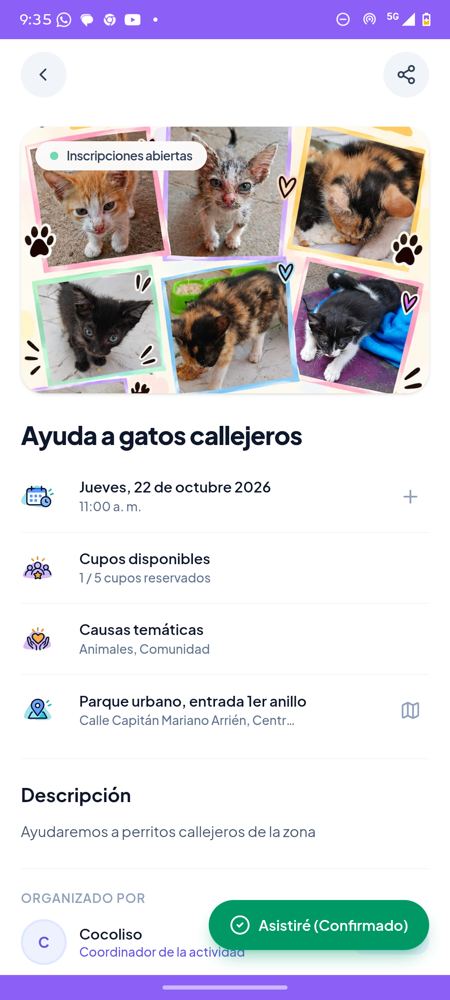
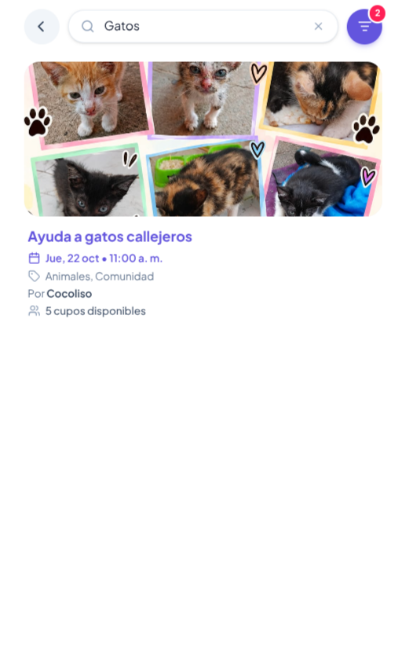

# 🧪 Evaluación Heurística de Usabilidad (Nielsen)

## 📌 Información del Proyecto
* **Materia:** Interacción Hombre-Computadora (IHC)
* **Proyecto:** Súmate App
* **Metodología:** 10 Heurísticas de Jakob Nielsen con escala estándar de severidad (0 a 4).

---

## 척 Escala de Severidad de Nielsen
* **0 - No es un problema:** No afecta la usabilidad.
* **1 - Cosmético:** Problema superficial; resolver solo si sobra tiempo.
* **2 - Menor:** Causa fricción o molestia baja; baja prioridad de resolución.
* **3 - Mayor:** Dificulta notablemente la tarea del usuario; alta prioridad.
* **4 - Catastrófico:** Impide completar la tarea; imperativo solucionarlo.

---

## 📊 Tabla de Evaluación Heurística

| Ruta | Problema y Consecuencia | Heurística (Nielsen) | Severidad (0-4) |
| :--- | :--- | :--- | :---: |
| `/activities/[id]` | **Ambigüedad entre etiqueta de estado y acción destructiva:** Al estar inscrito en la actividad, el botón flotante mostraba *"Asistiré (Confirmado)"* en verde con check. Parecía una etiqueta informativa inerte. El voluntario no sabía cómo darse de baja, o pulsaba por curiosidad y se topaba con la cancelación. Se solucionó cambiando el botón a una acción explícita: **"Cancelar participación"** en color rojo peligro con icono de retiro (`UserMinus`). | **H2: Correspondencia con el mundo real** (Afórdance de botones) **H4: Consistencia y estándares** | **3 (Mayor)** |
| `/activities/search` | **Falta de visibilidad de filtros activos en el encabezado:** El botón de filtros no indicaba si había filtros aplicados (por causa, fecha o distancia). El usuario olvidaba qué filtros dejó activos y no entendía por qué obtenía pocos resultados. Se solucionó añadiendo un **badge numérico dinámico** con la cantidad de filtros activos y destacando el botón en color primario. | **H1: Visibilidad del estado del sistema** **H6: Reconocimiento antes que recuerdo** | **2 (Menor)** |
| `/explore` | **Baja visibilidad y contraste en cupos disponibles:** La información de aforo se mostraba en texto gris plano indistinguible de los metadatos secundarios. El usuario no percibía con rapidez qué actividades tenían cupos libres o estaban a punto de agotarse. Se solucionó transformando los cupos disponibles en una **píldora visual destacada** con fondo y borde verde esmeralda contrastado. | **H1: Visibilidad del estado del sistema** **H8: Diseño estético y minimalista** | **2 (Menor)** |

---

## 📸 Evidencia Visual: Antes y Después

### 1. Detalle de Actividad (`/activities/[id]`)
> **Mejora:** Botón flotante al estar inscrito pasa de etiqueta estática verde a acción explícita de cancelación en rojo.

| Antes | Después |
| :---: | :---: |
|  |  |

---

### 2. Búsqueda y Filtros (`/activities/search`)
> **Mejora:** Botón de filtros en el encabezado con badge numérico dinámico y resaltado cuando hay filtros aplicados.

| Antes | Después |
| :---: | :---: |
|  |  |

---

### 3. Explorar Convocatorias (`/explore`)
> **Mejora:** Cupos disponibles destacados en tarjeta con píldora visual en color verde esmeralda.

| Antes | Después |
| :---: | :---: |
|  |  |
