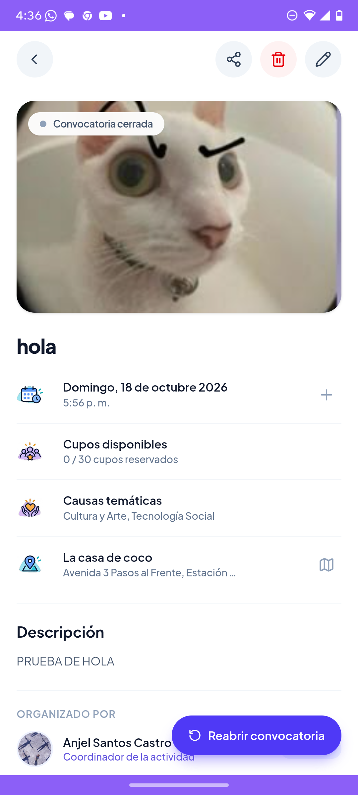
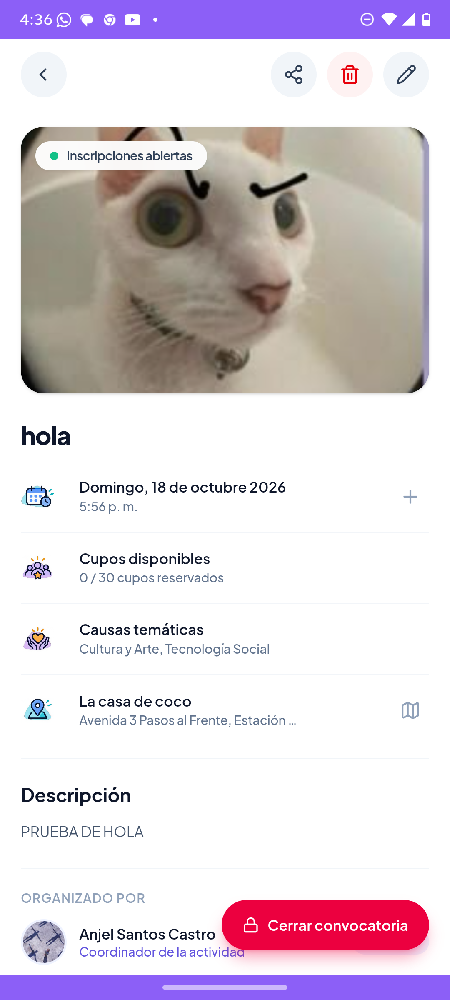
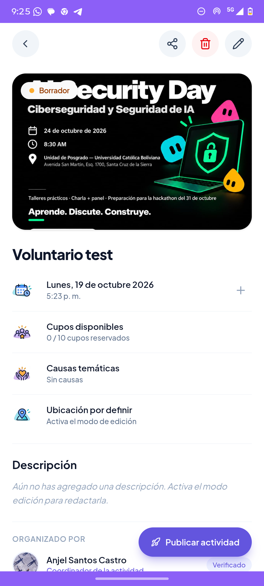
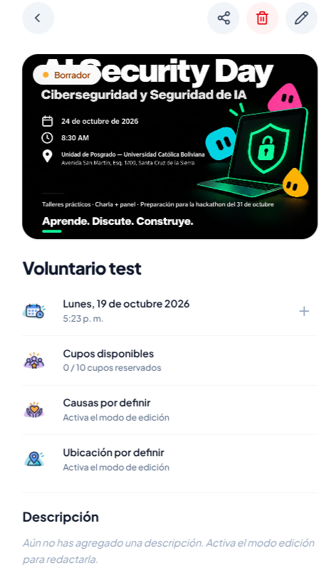

# 📐 Evaluación de Leyes y Principios de UX (IHC)

## 📌 Información General
* **Materia:** Interacción Hombre-Computadora (IHC)
* **Proyecto:** Súmate App
* **Alumno:** Santos Castro Roberto Anjel
* **Flujos Evaluados:** Detalle de Actividad (`/activities/[id]`), Búsqueda y Filtros (`/activities/search`), Creación de Actividades (`/my-activities`) y Exploración (`/explore`).
* **Principios Evaluados:** Ley de Fitts, Ley de Hick y Carga Cognitiva.

---

## 📊 Matriz de Evaluación de Leyes de UX

| Hallazgo | Captura (esta la agrego luego) | Justificacion breve | Estado al terminar |
| :--- | :---: | :--- | :---: |
| **1. Ley de Fitts** Dimensiones y ubicación de acciones críticas en Detalle de Actividad (`/activities/[id]`) y Crear actividad (`/my-activities`): Botones flotantes inferiores arrinconados a la derecha (`fixed bottom-6 right-5`), y acciones superiores en el header (*Compartir*, *Editar*, *Eliminar*). |    | Según la Ley de Fitts ($MT = a + b \log_2(2D/W)$), el tiempo para alcanzar un objetivo depende de la distancia ($D$) y del ancho ($W$) del blanco. Los botones flotantes periféricos tienen un ancho reducido (~140px) y una posición que dificulta el alcance ergonómico del pulgar (fuera de la zona natural de confort o Thumb Zone). En el header superior, los botones de acción son pequeños y requieren alta precisión. | **Requiere mejora** *(En proceso / Identificado con propuesta de mejora)* |
| **2. Ley de Hick** Sobrecarga de opciones simultáneas e inmediatas al desplegar el panel de filtros de búsqueda (`/activities/search`). |   | Conforme a la Ley de Hick ($T = b \log_2(n+1)$), el tiempo de decisión se incrementa logarítmicamente con el número de alternativas visibles. Inicialmente el panel mostraba 5 secciones abiertas en simultáneo (más de 15 chips y controles). Se solucionó jerarquizando las secciones en bloques colapsables: se dejan abiertas por defecto solo las 2 primarias (*Hora del día* y *Fecha*), se colapsa *Causas* y se agrupan los filtros secundarios (*Distancia* y *Asistentes*) en *"Más filtros"*. | **Requiere implementación** *(Implementado y corregido con código)* |
| **3. Carga Cognitiva** Flujo de creación progresiva de actividades y guía contextual en detalle (`/activities/[id]`): Creación rápida inicial y posterior enriquecimiento guiado en la pantalla de detalle para el organizador (*owner*). |    | Para evitar la sobrecarga cognitiva intrínseca de completar un formulario masivo de 15 campos en un solo paso, el sistema divide la carga mental (*Chunking* de Sweller): primero solicita los datos indispensables y permite al *owner* definir progresivamente detalles en el detalle. Para reducir la carga extraneous, se implementó en código que la interfaz guíe activamente al creador indicando *"Causas por definir"* (con *"Activa el modo de edición"* / *"Toca para seleccionar causas"*) al igual que *"Ubicación por definir"*. | **Requiere implementación** *(Implementado y corregido con código en detalle)* |

> [!NOTE]
> **Aclaración sobre los estados y requerimientos de implementación:**
> 1. **Filtros (Ley de Hick):** **SÍ requirió implementación en código** (`activity-search-filters-sheet.tsx`). Se implementó la lógica de secciones colapsables, persistencia al limpiar filtros y agrupación secundaria en "Más filtros" (ver evidencia antes `fitts.png` y después `mejora-filtro.png`).
> 2. **Causas y Guía en Detalle (Carga Cognitiva):** **SÍ requirió implementación en código** (`activity-detail-info.tsx`). El flujo base cumplía conceptualmente con la división en etapas, pero requirió implementar las etiquetas activas para que *Causas por definir* guíe al creador igual que la ubicación (ver antes `cogni2.png` y después `mejora-detail.png`).
> 3. **Detalle y Acciones (Ley de Fitts):** **Requiere una mejora técnica futura**. Se diagnosticó la necesidad de sustituir los botones flotantes periféricos por una *Sticky Bottom Bar* de ancho completo.

---

## 📸 Evidencia Visual (Capturas de Pantalla)

### 1. Ley de Fitts: Botones Flotantes Periféricos y Header Superior

Los botones de acción clave en la pantalla de detalle (`Reabrir convocatoria`, `Cerrar convocatoria`) y en la pantalla de Mis actividades (`+ Crear actividad`) se encuentran posicionados como botones flotantes arrinconados a la derecha (`fixed bottom-6 right-5`). Asimismo, en la parte superior del detalle se agrupan los iconos de *Compartir*, *Editar* y *Eliminar*.

| Detalle: Botón flotante inferior (Cerrada) | Mis Actividades: Botón flotante Crear | Detalle: Botón flotante inferior (Abierta) |
| :---: | :---: | :---: |
|  |  |  |

* **Diagnóstico bajo Fitts:** La distancia $D$ desde el centro de la pantalla o desde la mano izquierda hasta la esquina inferior derecha es mayor a la deseable, y el ancho $W$ (~140px) exige precisión en pantallas móviles. En el header superior, los iconos de 32x32px demandan puntería fina.
* **Propuesta de Mejora:** Reemplazar el botón flotante por una **Sticky Bottom Action Bar** fija en el borde inferior con botón de ancho completo (`w-full`), maximizando $W$ y minimizando $D$ en la *Thumb Zone*.

---

### 2. Ley de Hick: Panel de Filtros de Búsqueda (Antes vs Después)

El panel de filtros en `/activities/search` presentaba múltiples dimensiones de filtrado abiertas en simultáneo (*Hora del día*, *Fecha*, *Causas temáticas*, *Distancia* y *Tamaño de asistentes*).

| Antes (Todas las opciones abiertas y sobrecarga cognitiva) | Después: Implementación (Secciones colapsables y "Más filtros") |
| :---: | :---: |
|  |  |

* **Diagnóstico bajo Hick:** Al abrir el panel con todas las opciones simultáneamente visibles, la cantidad de estímulos incrementa el tiempo de reacción $T = b \log_2(n+1)$ y abruma al voluntario.
* **Solución Implementada:** Se implementaron secciones colapsables (solo *Hora* y *Fecha* desplegadas por defecto, *Causas* colapsada) y se unificaron *Distancia* y *Asistentes* dentro de una sola sección colapsable denominada **"Más filtros"**.

---

### 3. Carga Cognitiva: Creación Progresiva y Guías en Detalle (Antes vs Después)

El proceso de creación de una actividad divide la carga cognitiva en etapas para no saturar al usuario, requiriendo una implementación en la vista de detalle para guiar al organizador (*owner*).

| Paso 1: Creación ágil (Datos básicos) | Detalle Antes (Sin causas plano) | Detalle Después: Implementación ("Causas por definir" y guía) |
| :---: | :---: | :---: |
|  |  |  |

* **Fase 1 (Creación rápida):** El modal de creación (`CreateActivitySheet` en `cogni1.png`) solicita únicamente los datos indispensables para dar de alta el evento: título, fecha, aforo e imagen.
* **Fase 2 (Enriquecimiento en Detalle):** Una vez creada la actividad, el creador (*owner*) accede al detalle para completar la información secundaria.
* **Mejora Implementada en Código (`mejora-detail.png`):**
  - **Antes (`cogni2.png`):** Mostraba un texto inerte *"Causas temáticas: Sin causas"*, dejando incertidumbre sobre qué hacer.
  - **Después (`mejora-detail.png`):** Muestra reactivamente **`"Causas por definir"`** con la indicación **`"Activa el modo de edición"`** (o *"Toca para seleccionar causas"*), alineado con *"Ubicación por definir"*, reduciendo la carga cognitiva extraneous del usuario.

---

## 🔬 Detalle Teórico y Técnico por Principio

### 1. Ley de Fitts
* **Fórmula:**
  $$MT = a + b \cdot \log_2\left(\frac{2D}{W}\right)$$
* **Diagnóstico en Súmate App:**
  - El botón flotante inferior en `/activities/[id]` mide ~140px de ancho y está anclado en `fixed bottom-6 right-5`. En dispositivos móviles medianos y grandes, el pulgar debe forzar el movimiento diagonal hacia la esquina. En escritorio o tablet, el botón se separa del contenedor centrado de la app (`max-w-md`), incrementando la distancia $D$ drásticamente.
  - En la cabecera (`ActivityDetailHeader`), los botones de *Compartir*, *Editar* y *Eliminar* están agrupados en la barra superior (`w-8 h-8`), demandando precisión de puntero.
* **Oportunidad de Mejora:**
  - Integrar una **Sticky Bottom Action Bar** anclada al ancho del contenedor móvil con botón de ancho completo (`w-full`), maximizando $W$ y colocando la acción principal en la zona de menor distancia $D$ y menor tasa de error de pulsación.

---

### 2. Ley de Hick
* **Fórmula:**
  $$T = b \cdot \log_2(n + 1)$$
* **Diagnóstico en Súmate App:**
  - Al abrir el panel de filtros en `/activities/search`, el voluntario se encontraba con 5 bloques de decisión abiertos a la vez: *Hora del día*, *Fecha*, *Causas*, *Distancia* y *Tamaño de asistentes*.
* **Solución Implementada:**
  - **Secciones colapsables independientes:** Reducción del estímulo inicial visual a 2 categorías primarias (Hora y Fecha).
  - **Agrupación contextual:** Fusión de distancia y aforo en la sección *"Más filtros"*.
  - **Reseteo no destructivo:** "Limpiar todo" restablece los valores seleccionados sin cerrar las secciones que el usuario ya abrió, respetando su exploración.

---

### 3. Carga Cognitiva
* **Fundamento:** La memoria de trabajo humana tiene capacidad limitada (Teoría de la Carga Cognitiva de Sweller). Exigir toda la configuración de un evento en una sola pantalla satura la capacidad atencional del voluntario u organizador.
* **Diagnóstico en Súmate App:**
  - Si un usuario tuviera que definir mapa exacto, geolocalización por coordenadas, etiquetas de causas, descripción detallada y aforo en un solo formulario inicial, la tasa de abandono sería alta.
* **Solución y Comprobación en la Arquitectura:**
  - **División en etapas (Chunking):** Creación ágil en el Bottom Sheet inicial (`CreateActivitySheet`) y refinamiento posterior en el Detalle (`ActivityDetailView`).
  - **Señalización explícita para el creador (*owner*):** Se implementó la guía contextual activa en `activity-detail-info.tsx` (*"Causas por definir"* y *"Activa el modo de edición"*), eliminando la ambigüedad y completando la paridad con la ubicación.
