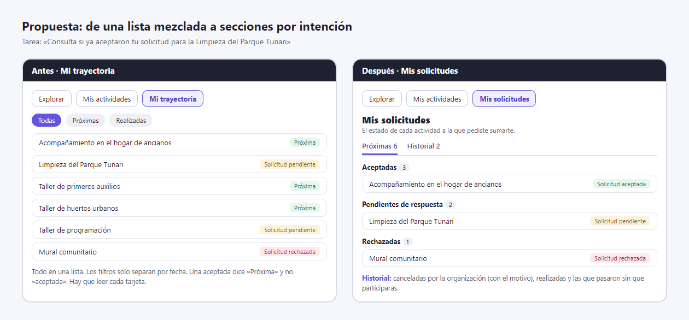
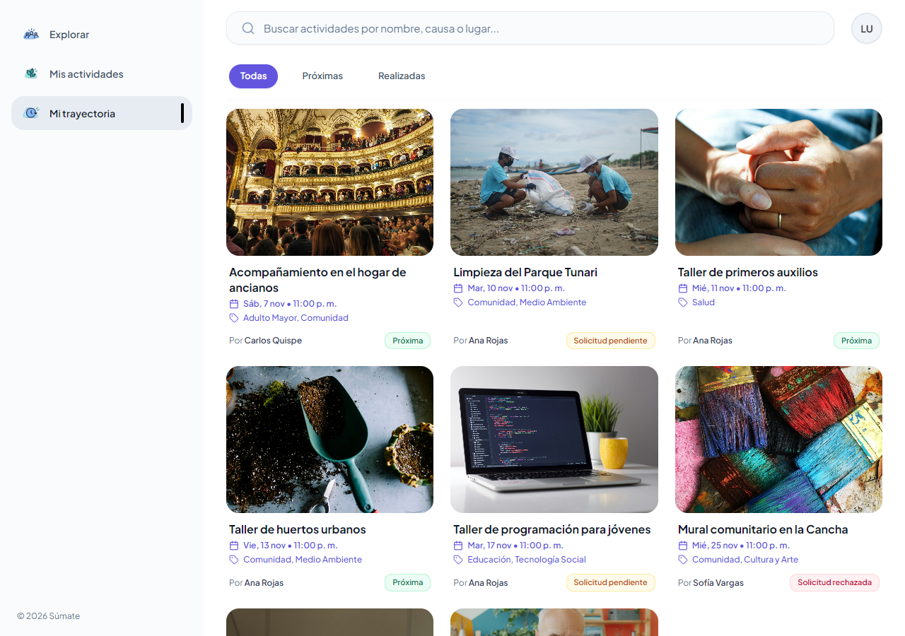
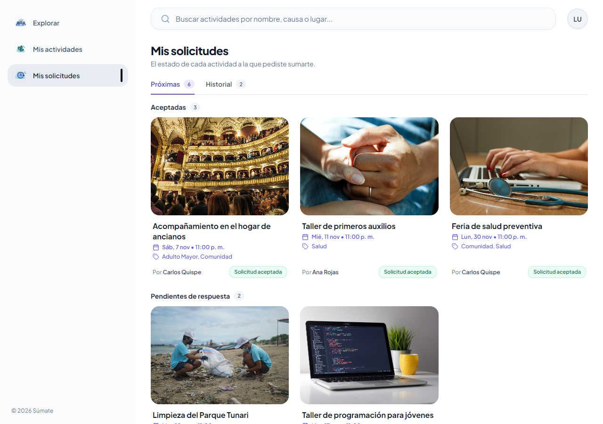
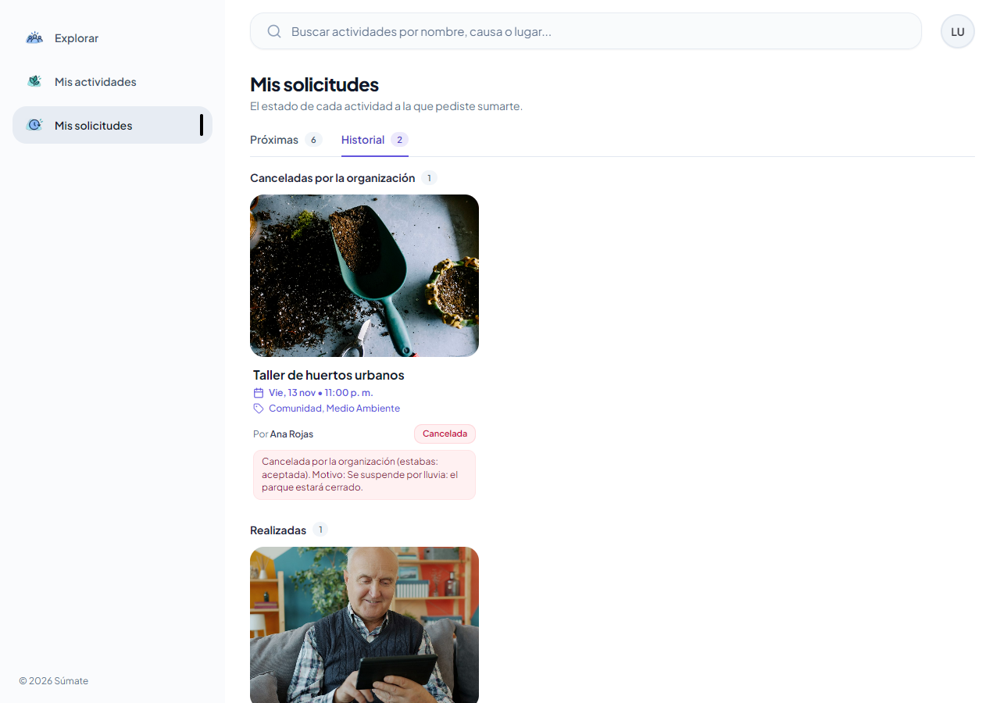

# Clase 20: arquitectura de información

Integrantes: Daniel Joaquin Mamani Pena y Faryd Lucas Soliz Marquez  
Proyecto: Súmate, caso Voluntariado Cerca  
Commit: [e6cc408 feat: organizar Mis solicitudes por estado y separar el historial](https://github.com/Joabits/sumate-app/commit/e6cc408)

## Problema

Parte de la app: Mi trayectoria, donde el voluntario ve las actividades a las que pidió sumarse.  
Tarea difícil: «Consulta si ya aceptaron tu solicitud para la Limpieza del Parque Tunari».  
Qué pasaba: la página mezclaba en una sola lista las solicitudes pendientes, aceptadas, rechazadas, en lista de espera, canceladas y realizadas. Los filtros Todas, Próximas y Realizadas solo separan por fecha, así que para responder había que leer tarjeta por tarjeta. Además una solicitud aceptada decía «Próxima», que no es un estado, y el nombre «Mi trayectoria» no anticipa que ahí están tus solicitudes.

## Propuesta

Secciones: el menú pasa a llamarse Mis solicitudes. La página tiene un título que dice qué contiene y dos secciones, Próximas e Historial.  
Etiquetas: en Próximas las tarjetas se agrupan por estado y cada grupo muestra su cantidad: Aceptadas, Pendientes de respuesta, En lista de espera y Rechazadas. En Historial quedan las canceladas por la organización con su motivo, las realizadas y las que pasaron sin que participaras.  
Acceso: se llega desde el menú principal en un toque, igual que antes, pero con un nombre que dice lo que hay adentro.

## Motivo

| Pregunta | Decisión |
|---|---|
| ¿Qué busca? | Saber si lo aceptaron en una actividad: es lo primero que consulta un voluntario después de solicitar |
| ¿Cómo lo llama? | «Mis solicitudes» anticipa el contenido mejor que «Mi trayectoria». Cada tarjeta usa el mismo nombre de estado que el detalle de la actividad: Solicitud pendiente, Solicitud aceptada, Solicitud rechazada y En lista de espera |
| ¿Dónde lo espera? | Separado por intención: lo que todavía puede pasar en Próximas y lo que ya terminó en Historial. Las secciones son pestañas de la página y no filtros de la lista |

## Antes y después

Antes, todo mezclado y la aceptada dice «Próxima»:

Después, Mis solicitudes agrupada por estado:

Historial, con la actividad cancelada y su motivo:

| Archivo | Cambio |
|---|---|
| [recently-feed.tsx](../client/src/features/participations/presentation/components/elements/recently-feed.tsx) | Secciones Próximas e Historial y grupos por estado con su cantidad |
| [navigation.config.ts](../client/src/features/shared/presentation/config/navigation.config.ts#L26) | El menú se llama Mis solicitudes |

## Prueba

Con otra persona, sin indicaciones: se le pide la tarea «Consulta si ya aceptaron tu solicitud para la Limpieza del Parque Tunari» con la cuenta luis@sumate.dev, sin decirle qué menú abrir.

| Persona y grupo | Resultado | Dónde dudó | Qué ajustamos |
|---|---|---|---|
| Por registrar en clase | Sin ayuda, con ayuda o no la encontró | | |

Automática: la prueba [Luis encuentra si ya aceptaron su solicitud sin revisar tarjeta por tarjeta](../client/tests/trayectoria.spec.ts#L23) entra por el menú Mis solicitudes y encuentra cada actividad en su grupo: Aceptadas, Pendientes de respuesta y Rechazadas. La suite completa, con lo de las tareas 6 y 7, pasa 31 de 31 en dos corridas seguidas.
