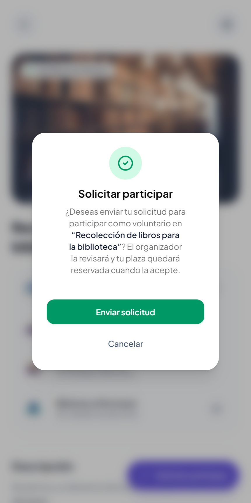
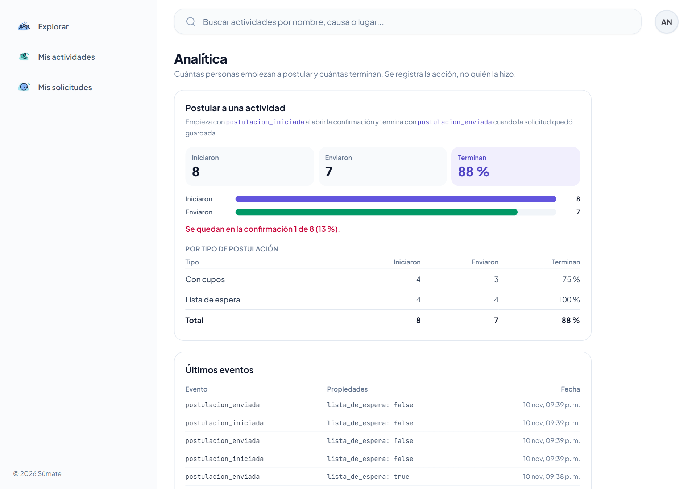

# Clase 21: analítica de interacción

Integrantes: Daniel Joaquin Mamani Pena y Faryd Lucas Soliz Marquez  
Proyecto: Súmate, caso Voluntariado Cerca  
Commit: [1d6c203 feat: medir cuántos empiezan y cuántos terminan la postulación](https://github.com/Joabits/sumate-app/commit/1d6c203)

## Pregunta

Flujo principal: postular a una actividad. La persona entra al detalle, toca Solicitar participar (o Unirme a la lista de espera si ya no hay cupos), confirma y la solicitud queda guardada.  
Pregunta: de los que empiezan a postular, ¿cuántos terminan enviando la solicitud?  
Qué decisión cambia: si la confirmación frena a la gente y cuál de las dos confirmaciones, con cupos o lista de espera, pierde más.

## Eventos

| Evento | Cuándo se dispara | Propiedades |
|---|---|---|
| `postulacion_iniciada` | Al tocar Solicitar participar o Unirme a la lista de espera, cuando se abre la confirmación | `lista_de_espera`: verdadero o falso |
| `postulacion_enviada` | Una vez, después de que el backend guardó la solicitud. Si falla, no se dispara | `lista_de_espera`: verdadero o falso |

Nombres: los de la tabla de la clase para Voluntariado Cerca, objeto y acción en pasado, en minúsculas y sin espacios.  
Propiedad: `lista_de_espera` dice cuál de las dos confirmaciones vio la persona. Tienen textos distintos y así se ve si una pierde más gente que la otra.  
Intentos: se cuentan intentos, no personas. Si alguien abre la confirmación, la cierra y vuelve a abrirla para enviar, quedan dos inicios y un envío.

La confirmación, donde empieza el embudo:

## Código

| Archivo | Qué hace |
|---|---|
| [track.ts](../client/src/analitica/track.ts) | `track(evento, props)` manda el evento al backend sin esperar la respuesta: si falla, la persona sigue con lo suyo. Los tipos solo aceptan las propiedades definidas |
| [ActivityDetailActions.tsx](../client/src/activities/components/ActivityDetailActions.tsx#L56) | `postulacion_iniciada` al abrir la confirmación y `postulacion_enviada` después de guardar la solicitud ([línea 74](../client/src/activities/components/ActivityDetailActions.tsx#L74)) |
| [evento.py](../server/app/models/evento.py) | Tabla `eventos`, la lista fija de eventos con sus propiedades y el conteo |
| [analitica_controller.py](../server/app/controllers/analitica_controller.py) | `POST /api/eventos` guarda y `GET /api/analitica` cuenta |
| [b4f1c8e2a7d3_eventos_de_analitica.py](../server/alembic/versions/b4f1c8e2a7d3_eventos_de_analitica.py) | Migración que crea la tabla en la misma base de datos de la app |
| [AnaliticaPage.tsx](../client/src/analitica/pages/AnaliticaPage.tsx) | Panel en `/analitica` |

La fecha la pone el servidor al guardar, así no depende del reloj del celular. Los dos endpoints piden sesión iniciada para que nadie de afuera llene la tabla, pero el evento no guarda quién lo mandó.

## Tabla eventos

Columnas: `id`, `evento`, `props` y `fecha`. No hay columna de usuario ni de actividad.

| evento | props | fecha |
|---|---|---|
| postulacion_iniciada | {"lista_de_espera": false} | 2026-11-11T01:38:32Z |
| postulacion_enviada | {"lista_de_espera": false} | 2026-11-11T01:38:32Z |
| postulacion_iniciada | {"lista_de_espera": true} | 2026-11-11T01:38:33Z |
| postulacion_enviada | {"lista_de_espera": true} | 2026-11-11T01:38:33Z |

## Panel

Está en `/analitica` y no aparece en el menú porque es para el equipo. Cuenta los eventos por nombre y por `lista_de_espera` y muestra los últimos 10.

Datos: para probar el panel vaciamos la tabla y corrimos una vez las 35 pruebas E2E. Iniciaron 8 y enviaron 7 (88 %). Con cupos terminan 3 de 4 (75 %) y en lista de espera 4 de 4. El que se quedó es la prueba que cierra la confirmación sin enviar, así que estos números muestran que la medición funciona; todavía no dicen cómo se comportan los voluntarios.

## Decisión

Pregunta guía: ¿qué cambiaríamos si supiéramos esto?  
Decisión: vamos a mirar la fila Lista de espera. Si ahí termina menos gente que con cupos, esa confirmación mostrará el puesto que te tocaría antes de confirmar («Quedarías en el puesto 3»), porque hoy solo dice que los cupos están llenos. Si las dos confirmaciones pierden gente por igual, la confirmación sobra y la solicitud se enviará con un toque, porque igual se puede cancelar después desde el mismo botón.

## Datos que decidimos no recopilar

Regla de la clase: si no lo necesitamos para responder la pregunta, no se guarda.

| Dato | Por qué no |
|---|---|
| Usuario, correo y nombre | Registramos la acción, no a la persona. Para contar intentos no hace falta saber quién fue |
| La actividad (id o nombre) | El embudo es de toda la app y la pregunta no compara actividades |
| Sesión | Contamos intentos y no necesitamos unir los eventos de una misma persona |
| Cupos libres, causa o fecha de la actividad | La pregunta no los necesita. `lista_de_espera` ya dice lo único que importa de los cupos |
| Texto escrito por el usuario | La postulación no tiene texto libre y, aunque lo tuviera, no responde la pregunta |

El backend hace cumplir la lista: un evento que no está en la lista responde 422, y una propiedad de más, que falta o de otro tipo responde 400. En los dos casos no se guarda nada.

## Prueba

| Prueba | Qué comprueba |
|---|---|
| [Postular guarda un inicio al abrir la confirmación y un envío solo cuando la solicitud se guarda](../client/tests/analitica.spec.ts#L22) | Carlos abre la confirmación y la cierra: solo hay un inicio. Vuelve y envía: dos inicios y un solo envío, los tres guardados (201) y cada uno solo con `lista_de_espera: false`. En lo que viaja no está su correo, su nombre, la actividad ni su id |
| [En una actividad llena los dos eventos dicen que la postulación fue a la lista de espera](../client/tests/analitica.spec.ts#L56) | Los dos eventos llevan `lista_de_espera: true` |
| [El panel /analitica muestra cuántos empiezan y cuántos terminan con los números del backend](../client/tests/analitica.spec.ts#L76) | Cada fila del panel coincide con lo que responde la API |
| [test_analitica_controller.py](../server/tests/controllers/test_analitica_controller.py) | El evento se guarda una vez y sin datos de la persona; se rechazan eventos fuera de la lista y propiedades de más (correo, actividad), que faltan o de otro tipo; el conteo separa con cupos y lista de espera |

Resultado: la suite E2E pasa 35 de 35 y el backend 136 de 136.
