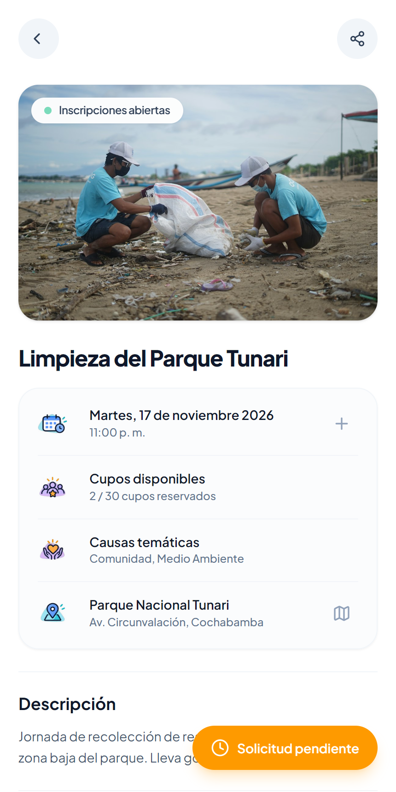
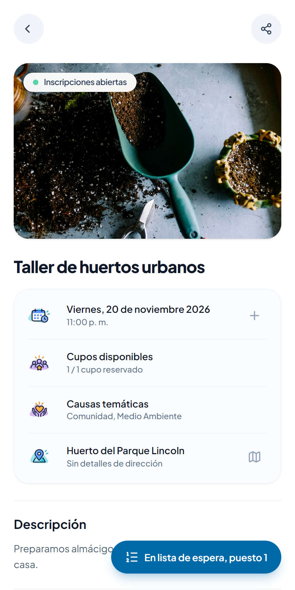
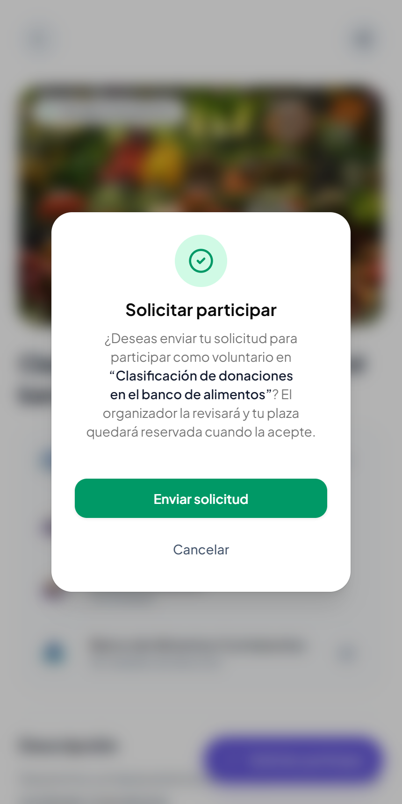
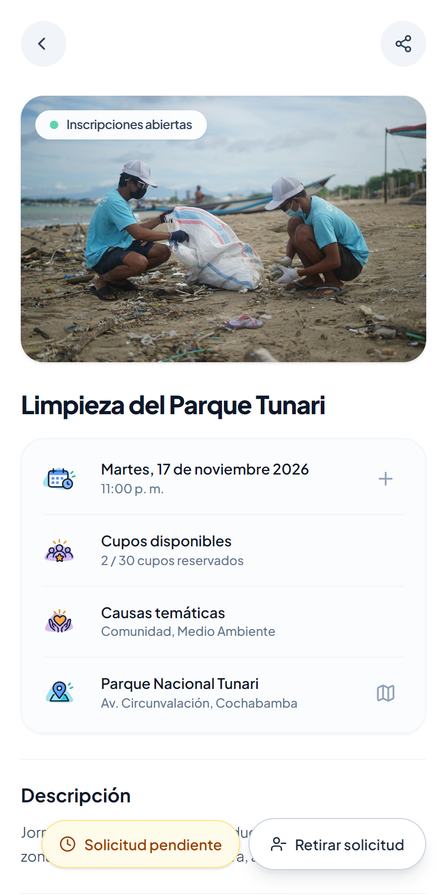
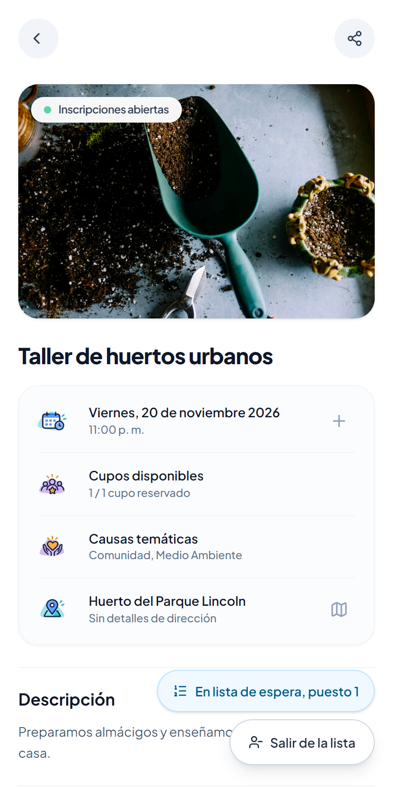
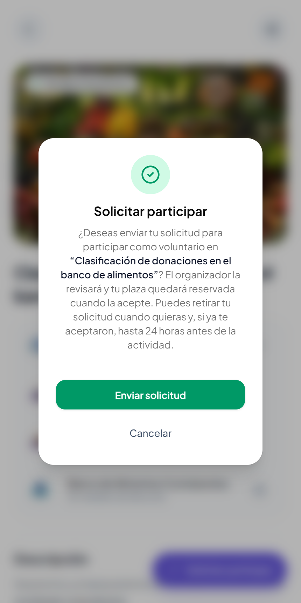

# Clase 22 · Patrones oscuros

Integrantes: Daniel Joaquin Mamani Pena y Faryd Lucas Soliz Marquez  
Modalidad: Sin AI

## 1. Patrón encontrado

Tipo (de los seis): 5, salir más difícil que entrar. Es el que la tabla de la clase marcaba para Voluntariado Cerca: retirarse escondido o sin explicar el plazo.  
Dónde: detalle de una actividad cuando la solicitud está pendiente o en lista de espera, en [ActivityDetailActions.tsx:237](../client/src/activities/components/ActivityDetailActions.tsx#L237), y la confirmación al postular, en [ConfirmJoinDialog.tsx:98](../client/src/participations/components/ConfirmJoinDialog.tsx#L98).  
Por qué es un patrón oscuro: para entrar hay un botón que dice lo que hace, «Solicitar participar». Para salir, la pantalla solo mostraba el estado, «Solicitud pendiente» o «En lista de espera, puesto 1», y ese mismo estado era el botón para retirarse. Nada lo decía: la pista estaba en un texto que aparece al pasar el mouse, y en el celular no aparece nunca. Además, al postular nadie avisaba que un aceptado solo puede retirarse hasta 24 horas antes; la persona se enteraba cuando ya no podía. Beneficia a la organización, que conserva postulantes que quizá ya no quieren ir. El voluntario no ve que puede salir ni hasta cuándo.

## 2. Antes

| Solicitud pendiente | En lista de espera | Confirmación al postular |
|---|---|---|
|  |  |  |

```tsx
// El estado era el botón de salida; solo el title, que el celular no muestra, decía que retira
<button onClick={abrirRetiro} title="Pulsa para retirar tu solicitud" className="... bg-amber-500 ...">
  <Clock />
  <span>Solicitud pendiente</span>
</button>
```

| Comparen | Entrar: postular | Salir: retirar la solicitud |
|---|---|---|
| Toques | 2 | 2, si uno adivina dónde tocar |
| Botón | Morado, con el nombre de la acción | La etiqueta naranja del estado |
| Texto | «Solicitar participar» | «Solicitud pendiente», no dice que retira |
| Consecuencias | Explicadas, pero sin el plazo para retirarse | Explicadas en el diálogo |

## 3. Después

| Solicitud pendiente | En lista de espera | Confirmación al postular |
|---|---|---|
|  |  |  |

```tsx
// El estado se muestra como estado y la salida es un botón que dice lo que hace
<p className="... bg-amber-50 ...">
  <Clock aria-hidden="true" />
  Solicitud pendiente
</p>
<button onClick={abrirRetiro} className={BOTON_SALIDA}>
  <UserMinus aria-hidden="true" />
  <span>Retirar solicitud</span>
</button>
```

```tsx
// El plazo sale de la misma regla que aplica el retiro
const HORAS_PLAZO_RETIRO = PLAZO_RETIRO_MS / (60 * 60 * 1000);

Puedes retirar tu solicitud cuando quieras y, si ya te aceptaron, hasta{" "}
{HORAS_PLAZO_RETIRO} horas antes de la actividad.
```

Commit: [8b379b6 fix(etica): retirarse se ve y se explica igual que postular](https://github.com/Joabits/sumate-app/commit/8b379b6)

| Comparen | Entrar: postular | Salir: retirar la solicitud |
|---|---|---|
| Toques | 2 | 2 |
| Botón | Morado, con el nombre de la acción | Blanco, del mismo tamaño y en el mismo lugar, con el nombre de la acción |
| Texto | «Solicitar participar» | «Retirar solicitud» o «Salir de la lista» |
| Consecuencias | Explicadas, con el plazo para retirarse | Explicadas en el diálogo |

No agregamos ninguna confirmación nueva: retirarse sigue teniendo una sola, igual que postular.

## 4. Principio aplicado

Nielsen #3, control y libertad: salir tiene que estar a mano. La salida ahora está en el mismo lugar que la entrada, con el mismo tamaño y el nombre de la acción, y cuesta los mismos dos toques.  
Honestidad, la interfaz dice la verdad: el plazo se explica antes de comprometerse. El número sale de la misma constante que aplica la regla (`PLAZO_RETIRO_MS`), así el texto no puede decir otra cosa que la regla.

## 5. Prueba

Archivo: [patrones-oscuros.spec.ts](../client/tests/patrones-oscuros.spec.ts)

| Prueba | Con el antes | Con el después |
|---|---|---|
| [Retirar una solicitud pendiente se ve como un botón y cuesta los mismos toques que postular](../client/tests/patrones-oscuros.spec.ts#L10) | Falla: «Solicitud pendiente» es un botón (esperado 0, encontrado 1) | Pasa |
| [Quien está en la lista de espera ve un botón para salir de ella](../client/tests/patrones-oscuros.spec.ts#L36) | Falla: no existe el botón «Salir de la lista» | Pasa |
| [Antes de postular, la confirmación explica hasta cuándo se puede retirar](../client/tests/patrones-oscuros.spec.ts#L54) | Falla: la confirmación no dice «hasta 24 horas antes de la actividad» | Pasa |

Suite completa después del cambio: E2E 47 de 47 y backend 151 de 151. Tres pruebas anteriores buscaban el estado como botón; ahora lo buscan como texto y usan los botones «Retirar solicitud» y «Salir de la lista».

## 6. Otros que encontramos

| Tipo | Dónde | Qué pasa |
|---|---|---|
| 6, permisos sin explicar | Buscar, [useActivitySearch.ts:88](../client/src/activities/hooks/useActivitySearch.ts#L88) | Cada búsqueda pide la ubicación del celular, aunque solo se escriba texto y sin decir para qué. El código lo llama pedirla «de forma discreta». Lo honesto sería pedirla solo al usar el filtro de distancia, explicando para qué, y dejar escribir la zona a mano |
| 5, salir más difícil que entrar | Cuenta | Crear una cuenta es un formulario, pero dentro de la app no hay cómo eliminarla |
