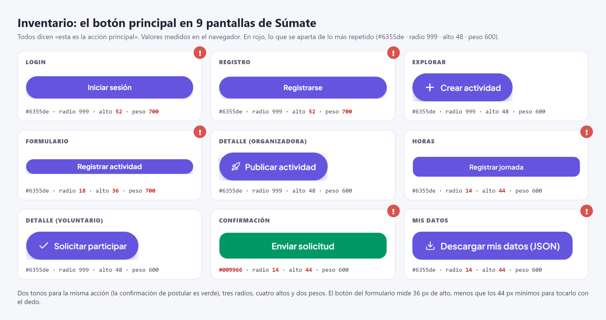

# Clase 23 · Inventario y tokens

Integrantes: Daniel Joaquin Mamani Pena y Faryd Lucas Soliz Marquez  
Modalidad: Sin AI

## 1. Inventario

El botón principal de nueve pantallas, uno al lado del otro. Los valores son los que calcula el navegador (color de fondo, radio, alto y peso de la letra), medidos con los usuarios de prueba.

| Diferencia | Dónde |
|---|---|
| Tono | La confirmación al postular, «Enviar solicitud», es verde (#009966). Las otras ocho acciones principales usan #6355de |
| Radio | Tres valores: 999 (píldora) en Login, Registro, Explorar y Detalle; 18 en el formulario de crear actividad; 14 en Horas, Confirmación y Mis datos |
| Alto | Cuatro valores: 52 en Login y Registro, 48 en Explorar y Detalle, 44 en Horas, Confirmación y Mis datos, y 36 en el formulario. El de 36 queda por debajo de los 44 px mínimos para tocar con el dedo |
| Peso de la letra | 700 en Login, Registro y el formulario; 600 en el resto |

## 2. Tokens

Nombrados por uso, no por apariencia. La app todavía tiene solo tema claro: los valores oscuros son la propuesta para cuando se agregue el tema oscuro.

| Token | Claro | Oscuro | Dónde se usa |
|---|---|---|---|
| `--color-accion` | #6355de | #a9a2ed | La acción principal: Iniciar sesión, Registrarse, Crear actividad, Solicitar participar, Publicar actividad, Registrar jornada y Descargar mis datos. Hoy está escrito a mano 138 veces en 45 archivos |
| `--color-texto` | #0f172b | #f1f5f9 | Títulos y texto principal (`text-slate-900`, 82 veces en 36 archivos) |
| `--color-fondo` | #ffffff | #0f172b | Fondo de las pantallas, tarjetas y diálogos (`bg-white`, 66 veces en 39 archivos) |
| `--color-error` | #ec003f | #ff637e | Acciones peligrosas y errores: Retirarme, Cerrar convocatoria, Cancelar actividad y los mensajes de error (`rose-500` a `rose-700`, 46 veces en 22 archivos) |
| `--radio-control` | 12px | 12px | Botones y campos de formulario. Hoy conviven `rounded-full` (132, también en avatares y etiquetas), `rounded-xl` (55), `rounded-2xl` (30), `rounded-md` (25), `rounded-3xl` (20) y `rounded-lg` (10) |

El tema ya tenía variables: `--app-primary` vale el mismo #6355de, pero solo la usa un archivo, [PrimaryButton.tsx](../client/src/shared/components/PrimaryButton.tsx); el resto escribe el valor. Para el error hay dos rojos: el tema define `--app-destructive` (#e7000b) y los botones usan `rose-600` (#ec003f).

## 3. Colores fijos

Pantalla revisada: detalle de una actividad, los once archivos `ActivityDetail*` (componentes y página).  
Qué buscamos: en VS Code, Ctrl+Shift+F con expresión regular `#[0-9a-fA-F]{6}\b|#[0-9a-fA-F]{3}\b|rgba?\(` y en «archivos a incluir» `**/ActivityDetail*`.  
Cuántos encontramos: 29 colores escritos a mano, 28 veces #6355de y una vez #5244cc (el hover), y ningún `rgb(`.

| Archivo | Colores fijos |
|---|---|
| [ActivityDetailInfo.tsx](../client/src/activities/components/ActivityDetailInfo.tsx) | 8 |
| [ActivityDetailActions.tsx](../client/src/activities/components/ActivityDetailActions.tsx) | 7 |
| [ActivityDetailParticipants.tsx](../client/src/activities/components/ActivityDetailParticipants.tsx) | 4 |
| [ActivityDetailOrganizer.tsx](../client/src/activities/components/ActivityDetailOrganizer.tsx) | 3 |
| [ActivityDetailHeader.tsx](../client/src/activities/components/ActivityDetailHeader.tsx) | 3 |
| [ActivityDetailTitle.tsx](../client/src/activities/components/ActivityDetailTitle.tsx) | 2 |
| [ActivityDetailDescription.tsx](../client/src/activities/components/ActivityDetailDescription.tsx) | 2 |

La misma pantalla usa además 200 clases de la paleta de Tailwind (`bg-slate-100`, `text-rose-600` y otras), que también son colores elegidos a mano en cada elemento. Hoy solo contamos: con `--color-accion`, cambiar el color de la acción principal sería cambiar una línea en vez de 28.
