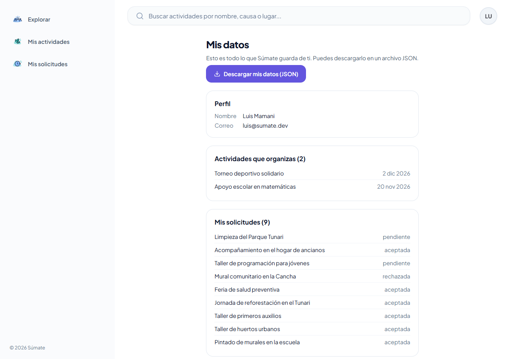
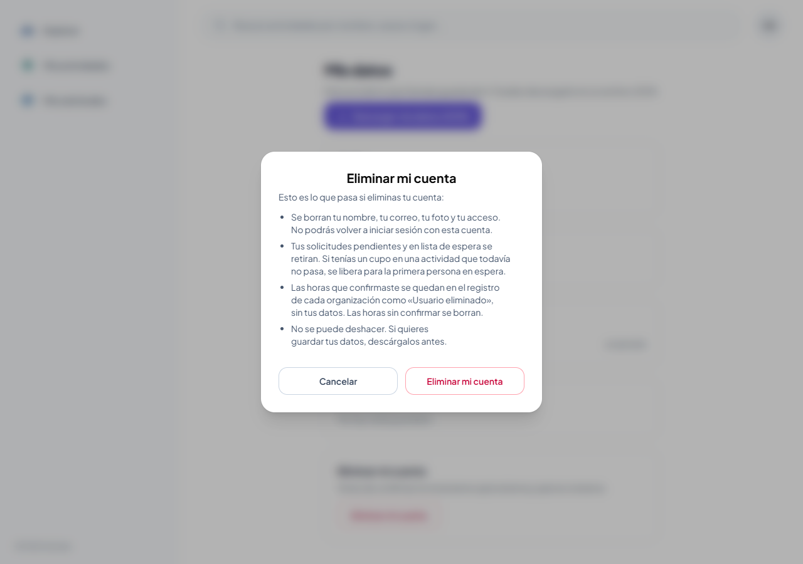
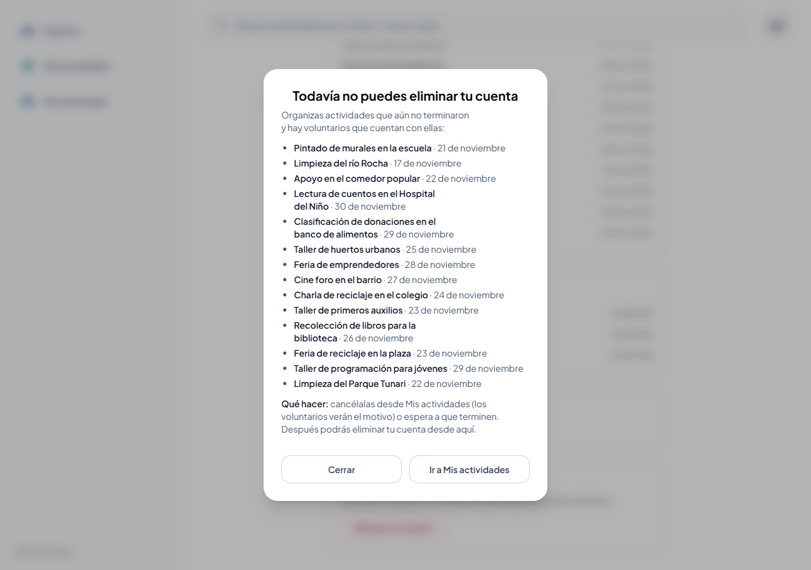
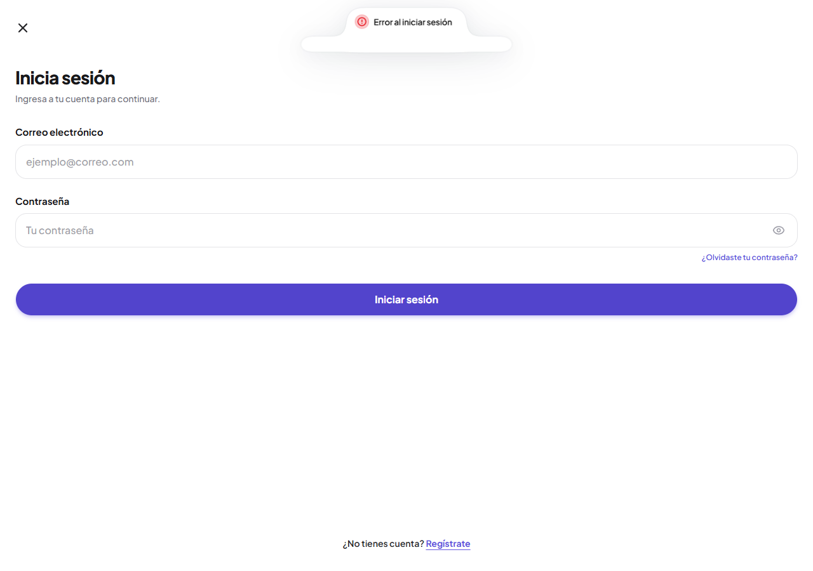
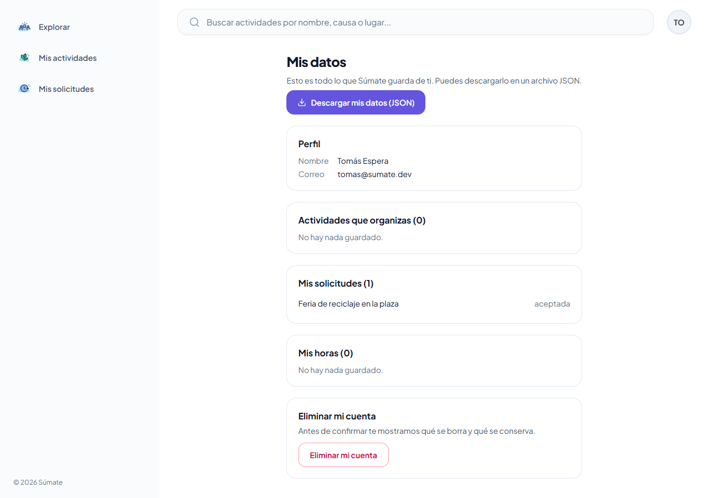

# Tarea 10 · Mis datos y salida honesta

Integrantes: Daniel Joaquin Mamani Pena y Faryd Lucas Soliz Marquez  
Modalidad: Con IA

Lo de la clase 22 aplicado a una funcionalidad completa: la persona ve sus datos, los descarga y elimina su cuenta sin obstáculos. Se entra desde el menú del perfil, en **Mis datos y cuenta** (`/mis-datos`).

## 1. Mis datos: ver y descargar (JSON)

- La página muestra todo lo que Súmate guarda de la persona: perfil (nombre y correo), actividades que organiza, sus solicitudes con su estado y sus horas con su estado.
- **Descargar mis datos (JSON)** baja `mis-datos-sumate.json` con la fecha de descarga y esas cuatro secciones, incluidos los motivos de retiro y de reclamo que la persona escribió.
- Backend: `GET /api/cuenta/mis-datos`, en [cuenta_controller.py](../server/app/controllers/cuenta_controller.py) y [CuentaService.mis_datos](../server/app/services/cuenta_service.py#L53).
- Frontend: [MisDatosPage.tsx](../client/src/cuenta/pages/MisDatosPage.tsx). La descarga se arma en [CuentaProvider.tsx](../client/src/cuenta/context/CuentaProvider.tsx).

## 2. Eliminar la cuenta con la regla de Voluntariado Cerca

Regla de la clase: *las horas confirmadas se conservan en la constancia de la organización, sin datos personales. Las solicitudes pendientes se retiran.*

`DELETE /api/cuenta` → [CuentaService.eliminar](../server/app/services/cuenta_service.py#L68). Todo pasa en una sola transacción:

| Dato | Qué pasa | Por qué |
|---|---|---|
| Solicitudes pendientes y en lista de espera | Pasan a `retirada` | Es lo que pide la regla |
| Cupo aceptado en una actividad que no pasó | Pasa a `retirada` y entra la primera persona en espera | La organización no pierde el cupo y la lista avanza igual que en un retiro normal |
| Horas **confirmadas** | Se conservan con un id anónimo (`eliminado-…`) y se ven como «Usuario eliminado» | La organización conserva su registro y el total de horas, sin nombre, correo ni foto |
| Horas sin confirmar (pendientes o en reclamo) | Se borran | Nunca formaron parte de una constancia, y el motivo del reclamo es texto que escribió la persona |
| Aceptado en una actividad que ya pasó | Se conserva, anónimo | Sus horas necesitan esa participación |
| Motivos de retiro escritos | Se borran | Es texto de la persona |
| Actividades que organizó y ya pasaron, canceladas o borradores | Se conservan sin organizador | Los voluntarios conservan su historial y el motivo de la cancelación |
| Fila `user` de Better Auth | Se borra. `session` y `account` caen con ella (`ON DELETE CASCADE`) | **Esa cuenta ya no puede iniciar sesión** |

**Cuándo bloquea:** si la persona organiza actividades publicadas o cerradas que todavía no pasaron, no se elimina, porque hay voluntarios que cuentan con ellas. El backend responde `409 CUENTA_CON_ACTIVIDADES_POR_TERMINAR` con un mensaje que dice **por qué** (cuáles actividades) y **qué hacer** (cancelarlas desde Mis actividades o esperar a que terminen). La app muestra lo mismo antes de intentar.

## 3. Confirmación honesta

| Confirmación | Intento bloqueado por la regla |
|---|---|
|  |  |

[EliminarCuentaDialog.tsx](../client/src/cuenta/components/EliminarCuentaDialog.tsx):

- **Botones del mismo tamaño y peso:** «Cancelar» y «Eliminar mi cuenta» usan la misma clase base ([`BOTON`](../client/src/cuenta/components/EliminarCuentaDialog.tsx#L25)), los dos con borde y sin relleno. Lo irreversible no se destaca ni se esconde (Nielsen #5).
- **Consecuencias explicadas:** qué se borra, qué se conserva (las horas como «Usuario eliminado»), qué pasa con el cupo y que no se puede deshacer.
- **Sin culpa:** no hay «¿Seguro?», ni «te vamos a extrañar», ni «tus voluntarios te necesitan». La E2E lo comprueba.
- **Sin pasos de más:** un clic abre la confirmación y otro elimina. Entrar también cuesta dos: el formulario de registro y su botón. No hay que escribir «ELIMINAR», no hay encuesta y no hay que pasar por soporte.
- **Bloqueo honesto:** si la regla bloquea, no aparece el botón de eliminar. Se dice por qué, con la lista de actividades, y qué hacer, con un botón a Mis actividades.

Después de eliminar, la sesión se cierra y la app vuelve al inicio. Al intentar entrar de nuevo con el mismo correo y contraseña:

Y el cupo de Valeria pasó a Tomás, que estaba en la lista de espera:

## 4. Revisión de los seis patrones en toda la app

| # | Patrón | Dónde miramos | Qué encontramos | Estado |
|---|---|---|---|---|
| 1 | Opciones preseleccionadas | Registro, crear actividad, filtros de búsqueda, postular | No hay casillas marcadas por defecto. Los filtros empiezan en «cualquiera» | Sin hallazgos |
| 2 | Confirmaciones engañosas | Retirarse, cancelar actividad, eliminar actividad, eliminar cuenta | Los botones dicen lo que hacen («Sí, retirarme», «Mantener mi lugar»). En **eliminar la cuenta** dejamos los dos botones con el mismo peso | Corregido en esta tarea (diálogo nuevo) |
| 3 | Urgencia o escasez falsa | Tarjetas y detalle de actividad | «N cupos disponibles» y «N / M cupos reservados» se calculan con los aceptados reales (`count_accepted`). No hay contadores ni «¡últimos cupos!» escritos fijos | Sin hallazgos |
| 4 | Datos expuestos sin necesidad | Detalle, participantes, horas, constancia | Los demás ven el nombre y la foto, nunca el correo. El correo solo aparece en la constancia propia. Al eliminar la cuenta, lo que se conserva queda como «Usuario eliminado» | Corregido en esta tarea (anonimizar al eliminar) |
| 5 | Salir más difícil que entrar | Retirarse de una actividad / **la cuenta** | Retirarse ya se había corregido en la clase 22 ([8b379b6](https://github.com/Joabits/sumate-app/commit/8b379b6)). La cuenta se creaba en un formulario, pero no había cómo eliminarla | **Corregido en esta tarea:** Mis datos y cuenta, dos clics |
| 6 | Permisos sin explicar | Buscar ([useActivitySearch.ts:88](../client/src/activities/hooks/useActivitySearch.ts#L88)) y elegir ubicación al crear | Al crear, la ubicación se pide al tocar «usar mi ubicación», y eso está bien. Pero **cada búsqueda pide la ubicación del celular**, aunque solo se escriba texto, y sin decir para qué | **Pendiente:** pedirla solo al usar el filtro de distancia, explicando para qué y con la opción de escribir la zona |

## 5. Eventos (los de la Tarea 9: inicio, éxito y bloqueo)

Se registra la acción, no a la persona. Ningún evento lleva correo, nombre, id ni nombres de actividades. El backend rechaza cualquier propiedad que no esté en la lista fija ([analitica_service.py](../server/app/services/analitica_service.py)).

| Evento | Cuándo | Propiedades | Dónde |
|---|---|---|---|
| `mis_datos_descargados` | Descargó el JSON | ninguna | [CuentaProvider.tsx:38](../client/src/cuenta/context/CuentaProvider.tsx#L38) |
| `eliminacion_cuenta_iniciada` | Abrió la confirmación (**inicio**) | ninguna | [CuentaProvider.tsx:42](../client/src/cuenta/context/CuentaProvider.tsx#L42) |
| `accion_rechazada` | La regla bloqueó (**bloqueo**) | `flujo: "eliminar_cuenta"`, `motivo: "actividades_por_terminar"` | [CuentaProvider.tsx:45](../client/src/cuenta/context/CuentaProvider.tsx#L45) y [:52](../client/src/cuenta/context/CuentaProvider.tsx#L52) si el backend responde 409 |
| `cuenta_eliminada` | El backend confirmó la eliminación (**éxito**) | ninguna | [CuentaProvider.tsx:56](../client/src/cuenta/context/CuentaProvider.tsx#L56). Se espera a que se guarde antes de cerrar la sesión |

El panel `/analitica` suma dos embudos: **Mis datos y eliminar la cuenta** (abrieron → eliminaron, con los rechazos por motivo) y **Descargar mis datos**.

## 6. Pruebas

**E2E**, en [mis-datos.spec.ts](../client/tests/mis-datos.spec.ts). Usa los usuarios `valeria@sumate.dev` y `tomas@sumate.dev`, que la semilla vuelve a crear en cada corrida.

| Prueba | Qué comprueba |
|---|---|
| [Mis datos muestra lo que la app guarda y lo descarga en JSON](../client/tests/mis-datos.spec.ts#L34) | La descarga del archivo, su contenido y el evento `mis_datos_descargados` |
| [Quien organiza actividades por terminar no puede eliminar la cuenta y ve por qué y qué hacer](../client/tests/mis-datos.spec.ts#L58) | El intento bloqueado: lista de actividades, qué hacer, que no haya botón de eliminar, y los eventos de inicio y de bloqueo |
| [Eliminar la cuenta: confirmación honesta, el cupo pasa al primero en espera y la cuenta ya no entra](../client/tests/mis-datos.spec.ts#L87) | La eliminación completa: consecuencias en el texto, sin culpa, botones del mismo tamaño, un clic, eventos de inicio y éxito sin datos personales, que el login falle después y que Tomás pase a aceptado |

**Backend**, en [test_cuenta_service.py](../server/tests/services/test_cuenta_service.py): Mis datos, el bloqueo con publicadas o cerradas, que las pasadas, canceladas y borradores no bloqueen, el retiro de solicitudes con promoción de la lista de espera, las horas confirmadas conservadas sin datos personales (las no confirmadas se borran) y el borrado de la fila de Better Auth.

Resultado: **E2E 50 de 50** y **backend 159 de 159**. Se ajustaron tres pruebas anteriores:

- el panel de analítica tiene dos embudos más (una prueba del backend y una E2E);
- un participante sin fila en `user` ahora se muestra como «Usuario eliminado» en vez de «Usuario».

## 7. Commits

Commits separados en `main`: backend, frontend, pruebas con su semilla, y esta evidencia.
