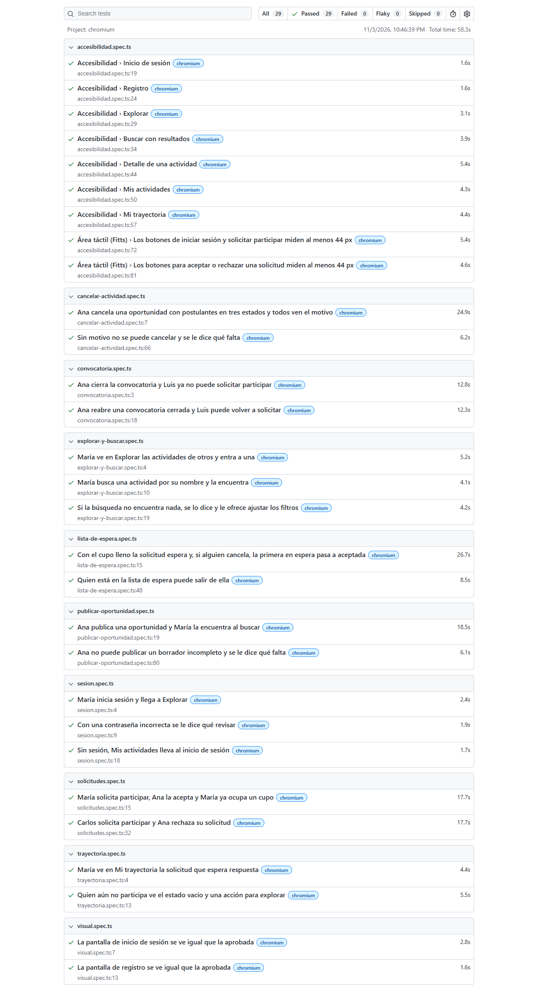
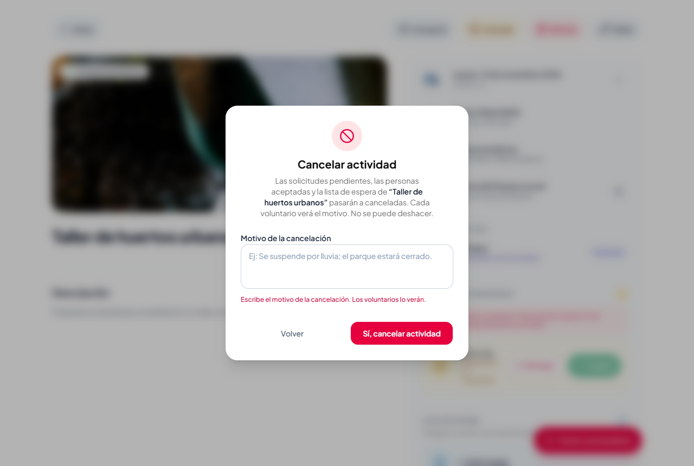
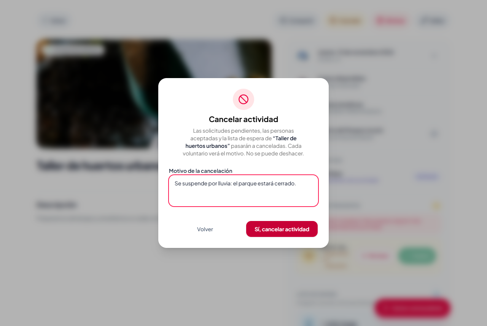
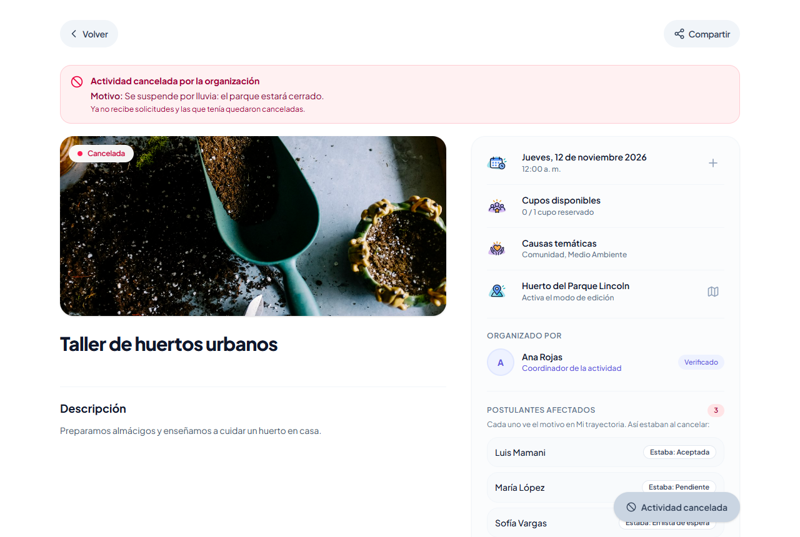
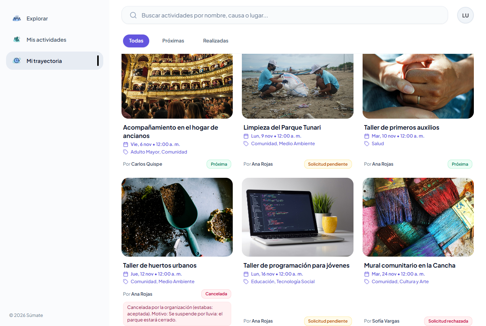
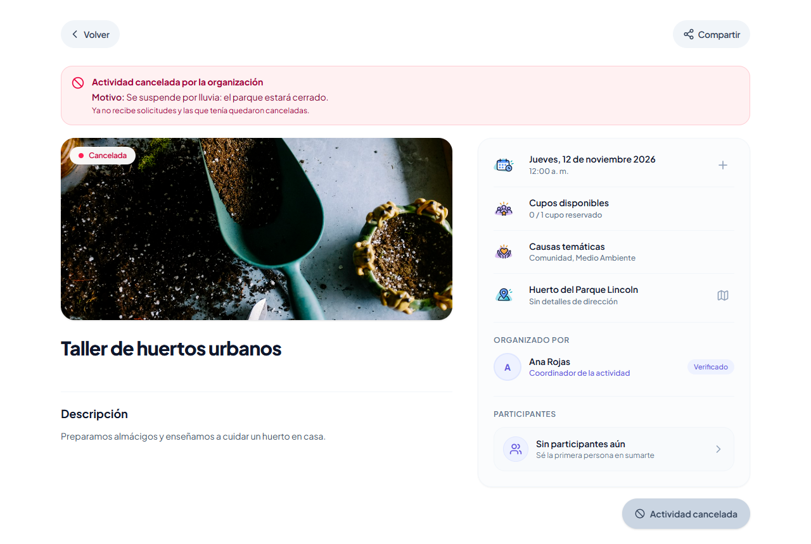

# Tarea 7: mejora por feedback y funcionalidad del caso

Fork: https://github.com/Joabits/sumate-app  
Caso: Voluntariado Cerca (Súmate)  
Commit de la funcionalidad: [46cf244 feat: cancelar una oportunidad con motivo obligatorio](https://github.com/Joabits/sumate-app/commit/46cf244)

## Funcionalidad del caso: cancelar una oportunidad

Requisito: la organización cancela una oportunidad con un motivo obligatorio. Las solicitudes pendientes, aceptadas y en lista de espera pasan a canceladas por la organización y conservan su estado anterior. Se bloquean nuevas solicitudes, aceptaciones y promociones. Cada voluntario afectado ve el motivo en sus participaciones.  
Escenario: Taller de huertos urbanos tiene un cupo, con Luis aceptado, María pendiente y Sofía en lista de espera. Ana lo cancela; los tres ven el motivo en Mi trayectoria y ya nadie puede solicitar ni ser aceptado.

Reglas que quedaron:  
Motivo: sin motivo no se cancela. Se guarda tal cual lo escribe la organizadora, hasta 500 caracteres.  
Cuándo: solo una actividad publicada (activa o con la convocatoria cerrada) que todavía no pasó. Un borrador no se cancela porque nadie lo ve.  
Solicitudes: pendientes, aceptadas y en lista de espera pasan a canceladas y guardan su estado anterior. Las rechazadas no cambian.  
Bloqueos: después de cancelar no se puede solicitar, aceptar, rechazar, salir ni entrar desde la lista de espera, y la actividad no se puede eliminar, publicar, cerrar ni reabrir.  
Historial: cada voluntario afectado ve en Mi trayectoria el motivo y el estado que tenía. La organizadora ve la lista de postulantes afectados con su estado anterior.  
Al mismo tiempo: al cancelar se bloquea la actividad con `FOR UPDATE`, así nadie es aceptado mientras se cancela.

| Parte | Cambio | Archivo |
|---|---|---|
| Datos | Columnas `motivo_cancelacion` en `activity` y `estado_anterior` en `participations` | [migración](../server/alembic/versions/c5e8a1d3f7b2_cancelar_actividad_con_motivo.py) |
| Regla | La actividad pasa a cancelada solo con motivo | [activity.py](../server/app/modules/activities/domain/entities/activity.py#L105) |
| Regla | Cada solicitud guarda su estado anterior al cancelarse | [participation.py](../server/app/modules/participations/domain/entities/participation.py#L76) |
| Regla | Cancela la actividad y a todos sus postulantes en una sola operación | [cancelar_actividad.py](../server/app/modules/activities/application/use_cases/cancelar_actividad.py#L40) |
| Bloqueos | Solicitar, aceptar o rechazar, salir, entrar desde la espera y eliminar | [join_activity.py](../server/app/modules/participations/application/use_cases/join_activity.py#L60), [revisar_solicitud.py](../server/app/modules/participations/application/use_cases/revisar_solicitud.py#L54), [leave_activity.py](../server/app/modules/participations/application/use_cases/leave_activity.py#L49), [lista_de_espera.py](../server/app/modules/participations/application/use_cases/lista_de_espera.py#L18), [delete_activity.py](../server/app/modules/activities/application/use_cases/delete_activity.py#L48) |
| API | `POST /api/activities/{id}/cancelar` con el motivo | [activity_router.py](../server/app/modules/activities/infrastructure/api/routers/activity_router.py#L609) |
| Consulta | Postulantes afectados para la organizadora y motivo en Mi trayectoria | [get_activity_detail.py](../server/app/modules/activities/application/queries/get_activity_detail.py#L136), [list_user_participations.py](../server/app/modules/participations/application/queries/list_user_participations.py#L92) |
| Pantalla | Botón Cancelar y diálogo con el motivo obligatorio | [activity-detail-header.tsx](../client/src/features/activities/presentation/components/elements/activity-detail-header.tsx#L117), [cancelar-actividad-dialog.tsx](../client/src/features/activities/presentation/components/dialogs/cancelar-actividad-dialog.tsx) |
| Pantalla | Aviso de cancelación para todos y postulantes afectados para la organizadora | [aviso-cancelacion.tsx](../client/src/features/activities/presentation/components/elements/aviso-cancelacion.tsx), [postulantes-cancelados.tsx](../client/src/features/activities/presentation/components/elements/postulantes-cancelados.tsx) |
| Pantalla | Sin acciones en una actividad cancelada | [activity-detail-actions.tsx](../client/src/features/activities/presentation/components/elements/activity-detail-actions.tsx#L176) |
| Pantalla | Mi trayectoria muestra el motivo y el estado anterior | [recently-feed.tsx](../client/src/features/participations/presentation/components/elements/recently-feed.tsx#L108) |

### Pruebas

| Prueba | Qué comprueba | Resultado |
|---|---|---|
| E2E | Ana cancela una oportunidad con postulantes en tres estados y todos ven el motivo | Pasa |
| E2E | Sin motivo no se puede cancelar y se le dice qué falta | Pasa |
| Backend | 24 casos en [test_cancelar_actividad.py](../server/tests/unit/test_cancelar_actividad.py), uno con una base real en memoria que revisa lo que queda guardado | Pasan |
| Suite de la Tarea 6 | Las 27 pruebas anteriores más las 2 nuevas, dos corridas seguidas desde la semilla | 29 de 29 las dos veces |
| Backend completo | `venv\Scripts\python -m pytest` | 113 pasan |

Las pruebas de la Tarea 6 se mantienen: la suite completa pasa con la funcionalidad nueva.

### Evidencia

Sin motivo no se puede cancelar y se le dice qué falta:

Ana escribe el motivo:

Después de cancelar, todos ven el aviso y el motivo. Ana ve a los tres postulantes con el estado que tenían:

Luis, que estaba aceptado, ve en Mi trayectoria la cancelación y el motivo:

Otra persona abre la actividad: ve el motivo y ya no puede solicitar participar:

