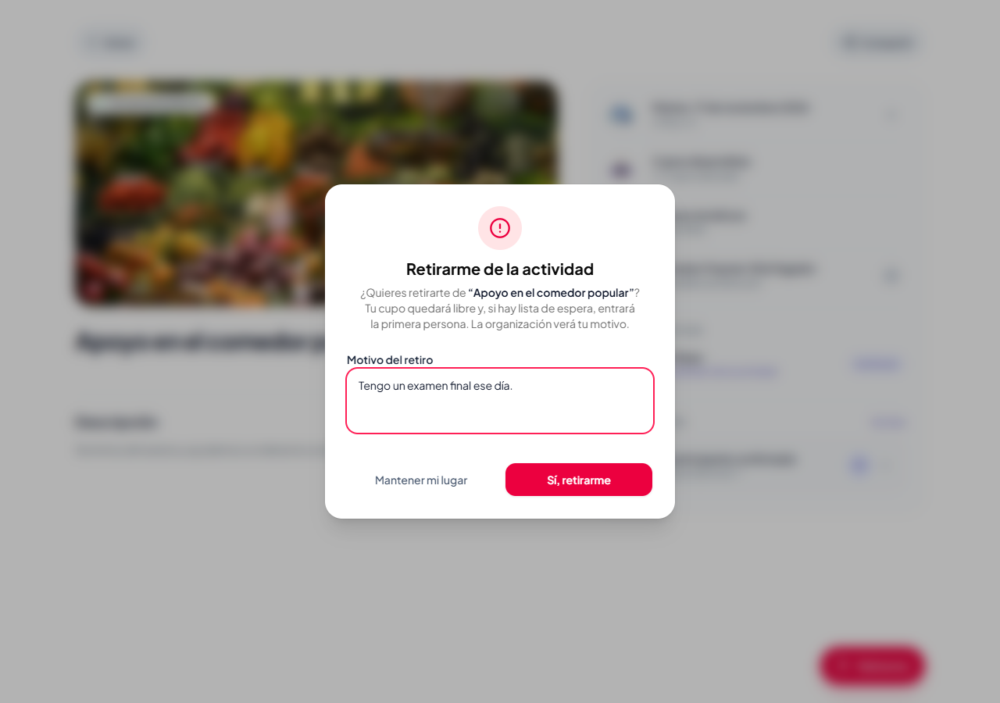
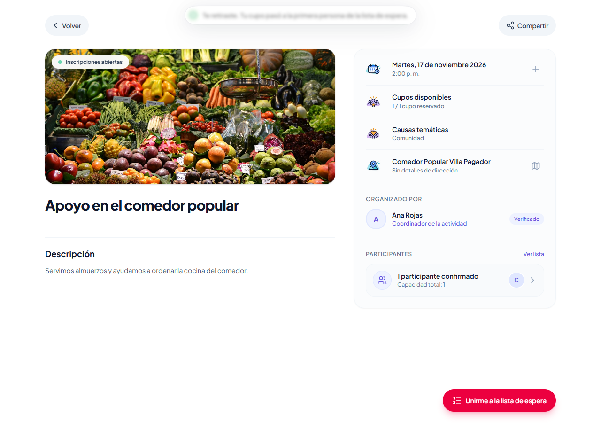
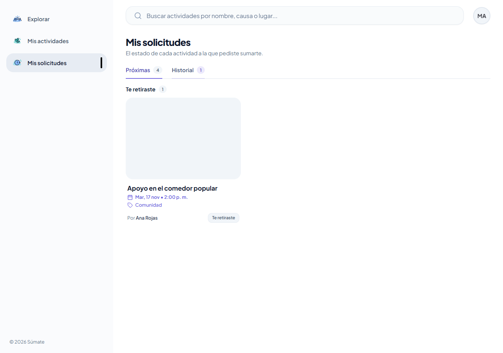
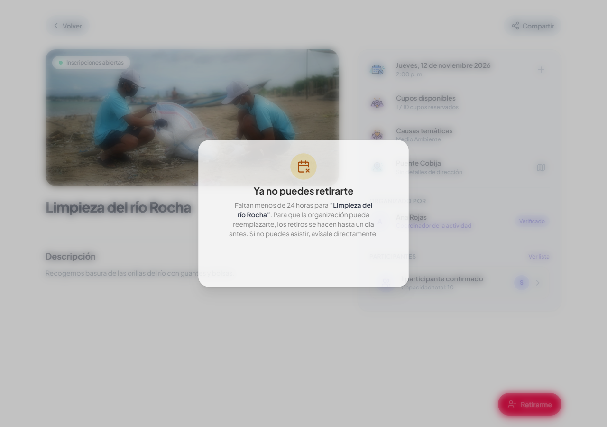
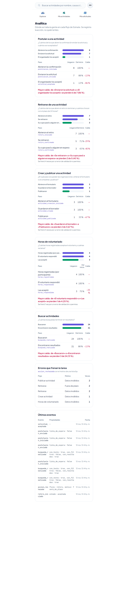

# Tarea 9: retirarse de una actividad y analítica en todo el producto

Integrantes: Daniel Joaquin Mamani Pena y Faryd Lucas Soliz Marquez  
Proyecto: Súmate, caso Voluntariado Cerca  
Commits:

- Parte B, funcionalidad: [0afd7a0 feat: retirarse de una actividad con motivo y plazo de 24 horas](https://github.com/Joabits/sumate-app/commit/0afd7a0)
- Parte A, analítica: [61070f3 feat: analítica en todos los flujos principales con un embudo por flujo](https://github.com/Joabits/sumate-app/commit/61070f3)

---

# Parte B: retirarse de una actividad

## Reglas

| Quién se retira | Qué pasa |
|---|---|
| Aceptado, faltando 24 horas o más | Escribe el motivo (obligatorio, hasta 500 caracteres). Su cupo queda libre y entra el primero de la lista de espera |
| Aceptado, faltando menos de 24 horas | **No se permite.** La app le explica que avise directamente a la organización y el backend responde `409 RETIRO_FUERA_DE_PLAZO` |
| Pendiente o en lista de espera | Retira su solicitud sin motivo, porque no ocupaba un cupo. Puede hacerlo hasta que empiece la actividad |

La solicitud no se borra: queda como `retirada`, con el motivo si era un aceptado. Aparece en Mis solicitudes › Historial › «Te retiraste» y la persona puede volver a postular.

## Código

| Archivo | Qué hace |
|---|---|
| [participation_service.py](../server/app/services/participation_service.py#L118) | `retirarse()`: valida el plazo de 24 h ([`PLAZO_RETIRO`](../server/app/services/participation_service.py#L47)) y el motivo, marca la solicitud como `retirada` y llena el cupo con el primero en espera. Todo pasa con la actividad bloqueada (`FOR UPDATE`) |
| [participation_controller.py](../server/app/controllers/participation_controller.py#L32) | `POST /api/participaciones/{id}/retiro` con `{ motivo }`. Responde `{ estado_anterior, entro_de_lista_de_espera }` |
| [f3b9d2e6a1c4_retirarse_de_una_actividad.py](../server/alembic/versions/f3b9d2e6a1c4_retirarse_de_una_actividad.py) | Migración: columna `motivo_retiro` |
| [ParticipationsProvider.tsx](../client/src/participations/context/ParticipationsProvider.tsx#L64) | `retirarse()` valida antes de llamar al backend: plazo ([`retiroFueraDePlazo`](../client/src/participations/context/ParticipationsProvider.tsx#L15)) y motivo |
| [RetirarseDialog.tsx](../client/src/participations/components/RetirarseDialog.tsx) | Confirmación con motivo para un aceptado, sin motivo para un pendiente o en espera, y aviso «Ya no puedes retirarte» si está fuera de plazo |

## Capturas

Un aceptado escribe el motivo:



Se retira a tiempo y su cupo pasa al primero en espera:



Queda en el historial de Mis solicitudes:



Fuera de plazo, la app no lo permite:



## Pruebas

| Prueba | Qué comprueba |
|---|---|
| [Un aceptado se retira a tiempo con motivo: libera el cupo y entra el primero en espera](../client/tests/retirarse.spec.ts#L7) | Sin motivo no deja retirarse. Con motivo, María se retira y Carlos, que estaba primero en espera, pasa a aceptado. Ana ve 1 confirmado y la lista de espera vacía. A María le aparece «Te retiraste» en el historial |
| [Un pendiente retira su solicitud sin escribir motivo](../client/tests/retirarse.spec.ts#L48) | El diálogo no pide motivo y, al recargar, la solicitud ya no está |
| [Fuera de plazo la app no permite retirarse y la persona sigue aceptada](../client/tests/retirarse.spec.ts#L62) | En una actividad que empieza en menos de 24 h no hay botón para confirmar. Al recargar, Sofía sigue aceptada |
| [test_participation_controller.py](../server/tests/controllers/test_participation_controller.py#L73) | Backend: retiro a tiempo con promoción, motivo vacío o de más de 500 caracteres, un aceptado a 23 horas rechazado, un pendiente a menos de 24 h sí puede, rechazada o sin solicitud, actividad pasada y volver a postular después de retirarse |

---

# Parte A: analítica en todo el producto

## App map: dónde va cada evento

```
Buscar ──▶ Detalle ──▶ Confirmación ──▶ Solicitud guardada ──▶ Organizador acepta
  ●busqueda_realizada  ●postulacion_iniciada   ●postulacion_enviada   ●solicitud_aceptada
                │
                └─▶ Retirarme ──▶ Confirmación (motivo) ──▶ Retiro guardado
                    ●retiro_iniciado   ✖accion_rechazada      ●retiro_confirmado
                                       (fuera_de_plazo / validacion)

Mis actividades ──▶ Crear ──▶ Borrador guardado ──▶ Completar ──▶ Publicar
                    ●actividad_creacion_iniciada  ●actividad_creada  ●actividad_publicada
                    ✖accion_rechazada (crear_actividad / publicar_actividad, validacion)

Actividad terminada ──▶ Organización registra horas ──▶ Voluntario acepta / reclama
                        ●horas_registradas              ●horas_respondidas
                        ✖accion_rechazada (horas, validacion…)
```

● evento de inicio, paso o éxito · ✖ evento de error (validación o permiso)

## Plan de eventos

Todos los eventos de éxito se disparan **después** de que el backend guardó, nunca al tocar el botón.

| Evento | Flujo | Propiedades | Archivo:línea | Pregunta |
|---|---|---|---|---|
| `postulacion_iniciada` | Postular | `lista_de_espera` | [ActivityDetailActions.tsx:76](../client/src/activities/components/ActivityDetailActions.tsx#L76) | ¿Cuántos empiezan a postular? |
| `postulacion_enviada` | Postular | `lista_de_espera` | [ActivityDetailActions.tsx:94](../client/src/activities/components/ActivityDetailActions.tsx#L94) | ¿Cuántos de los que empiezan envían la solicitud? |
| `solicitud_aceptada` | Postular | — | [SolicitudesPendientes.tsx:46](../client/src/activities/components/SolicitudesPendientes.tsx#L46) | ¿Cuántas solicitudes enviadas terminan aceptadas por el organizador? |
| `retiro_iniciado` | Retirarse (T9) | `estado`: pendiente, aceptada o en_espera | [ActivityDetailActions.tsx:66](../client/src/activities/components/ActivityDetailActions.tsx#L66) | ¿Cuántos abren el retiro y desde qué estado? |
| `retiro_confirmado` | Retirarse (T9) | `estado`, `entro_de_lista_de_espera` | [ActivityDetailActions.tsx:386](../client/src/activities/components/ActivityDetailActions.tsx#L386) | ¿Cuántos terminan el retiro y cuántos cupos aprovecha la lista de espera? |
| `actividad_creacion_iniciada` | Crear y publicar | — | [CreateActivitySheet.tsx:25](../client/src/activities/components/CreateActivitySheet.tsx#L25) | ¿Cuántas organizaciones empiezan a crear una actividad? |
| `actividad_creada` | Crear y publicar | — | [CreateActivityForm.tsx:61](../client/src/activities/components/CreateActivityForm.tsx#L61) | ¿Cuántas llegan a guardar el borrador? |
| `actividad_publicada` | Crear y publicar | — | [ActivityDetailActions.tsx:129](../client/src/activities/components/ActivityDetailActions.tsx#L129) | ¿Cuántos borradores llegan a publicarse? |
| `horas_registradas` | Horas (T8) | `participantes` (entero) | [RegistrarJornadaForm.tsx:45](../client/src/horas/components/RegistrarJornadaForm.tsx#L45) | ¿Cuántas horas por participante se registran? |
| `horas_respondidas` | Horas (T8) | `respuesta`: aceptadas o reclamadas | [MisHoras.tsx:31](../client/src/horas/components/MisHoras.tsx#L31), [ReclamarHorasDialog.tsx:58](../client/src/horas/components/ReclamarHorasDialog.tsx#L58) | ¿Cuántas horas acepta el voluntario y cuántas reclama? |
| `busqueda_realizada` | Buscar | `con_texto`, `con_filtros`, `con_resultados` | [useActivitySearch.ts:104](../client/src/activities/hooks/useActivitySearch.ts#L104) | ¿Cuántas búsquedas terminan sin resultados, y si pasa más con filtros? |
| `accion_rechazada` | Todos | `flujo` y `motivo` de una lista fija | [AnaliticaProvider.tsx:51](../client/src/analitica/context/AnaliticaProvider.tsx#L51) (`trackRechazo`), [ActivityDetailActions.tsx:68](../client/src/activities/components/ActivityDetailActions.tsx#L68), [ActivityDetailActions.tsx:110](../client/src/activities/components/ActivityDetailActions.tsx#L110), [ReclamarHorasDialog.tsx:46](../client/src/horas/components/ReclamarHorasDialog.tsx#L46) | ¿Qué error frena más cada flujo? |

Listas fijas de `accion_rechazada`:

- `flujo`: `postulacion`, `retiro`, `crear_actividad`, `publicar_actividad` o `horas`.
- `motivo`: `fuera_de_plazo`, `sin_cupos`, `sin_permiso`, `validacion`, `actividad_cancelada` o `conflicto`.

[`motivoDeRechazo`](../client/src/analitica/context/AnaliticaProvider.tsx#L21) traduce el código del backend a un motivo de esa lista. Los errores de red, sesión vencida o del servidor no se registran porque no son una regla que frene la tarea.

El backend hace cumplir el plan en [analitica_service.py](../server/app/services/analitica_service.py#L48): un nombre fuera de la lista responde 422. Una propiedad de más, que falta, de otro tipo, fuera de la lista fija o un entero fuera de rango responde 400. En ningún caso se guarda.

## Datos que decidimos no recopilar

| Dato | Por qué no |
|---|---|
| Usuario, correo, nombre y sesión | Registramos la acción, no a la persona. Las preguntas cuentan intentos, no necesitan unir eventos de una misma persona |
| La actividad (id o nombre) | Los embudos son de toda la app y ninguna pregunta compara actividades |
| **Motivo escrito al retirarse** y motivo de un reclamo de horas | Es texto escrito por la persona. Se guarda en la solicitud para la organización, pero no en la analítica. El panel solo necesita saber que hubo un retiro |
| **Texto buscado** y causas o filtros elegidos | El texto puede tener datos personales. Para «¿cuántas búsquedas terminan sin resultados?» basta con `con_texto` y `con_filtros` como verdadero o falso |
| Cantidad de horas registradas | La pregunta es si el voluntario las acepta, no cuántas horas fueron. Solo guardamos cuántos participantes había en la jornada |
| Mensaje del error | Puede repetir lo que escribió la persona. Lo reemplaza un motivo de la lista fija |
| Clics, pantallas abiertas y estados intermedios | No responden ninguna pregunta del plan |

## Panel `/analitica`

Muestra un embudo por flujo: cuántos llegan a cada paso, el porcentaje desde el inicio, la caída entre pasos y la mayor caída del flujo. Debajo están los errores que frenan la tarea, por flujo y motivo, y los últimos 10 eventos. El backend agrupa los eventos por nombre y propiedades y arma los embudos según [`EMBUDOS`](../server/app/services/analitica_service.py#L85).



**Datos**: vaciamos la tabla `eventos` local y corrimos una vez la suite E2E (44 pruebas). Son intentos de las pruebas, no de voluntarios reales: confirman que cada flujo registra sus eventos, pero las caídas reflejan cómo están escritas las pruebas.

| Embudo | Pasos | Mayor caída |
|---|---|---|
| Postular | 8 abrieron → 7 enviaron → 1 aceptada | Enviaron → aceptada: −86 % (6 de 7) |
| Retirarse | 7 abrieron → 5 se retiraron → 3 cupos pasaron a alguien en espera | Se retiraron → cupo reasignado: −40 %. Antes de eso se pierden 2 de 7, los dos por `fuera_de_plazo` |
| Crear y publicar | 3 abrieron → 3 guardaron el borrador → 1 publicó | Borrador → publicada: −67 % (2 de 3) |
| Horas | 4 registradas → 4 respondidas → 3 aceptadas | Respondidas → aceptadas: −25 % (1 reclamo) |
| Buscar | 24 búsquedas → 21 con resultados | −13 % sin resultados |

Errores: `publicar_actividad/validacion` 2, `retiro/fuera_de_plazo` 2, `retiro/validacion` 2, `crear_actividad/validacion` 1 y `horas/validacion` 1.

## El paso con la mayor caída y qué cambiaríamos

**Mayor caída: Postular, de «Enviaron la solicitud» a «El organizador los aceptó» (−86 %).** En estos datos ocurre porque solo una prueba hace que Ana revise solicitudes. Aun así, el embudo muestra un riesgo real: el último paso depende de que el organizador entre a cada actividad para ver las solicitudes pendientes, y nada lo avisa.  
**Qué cambiaríamos:** mostrar en cada tarjeta de Mis actividades cuántas solicitudes esperan respuesta («3 por revisar»). Así el organizador no tiene que abrir actividad por actividad. Lo mediríamos con la misma caída de este embudo.

Segunda caída: **Crear y publicar, de borrador a publicada (−67 %)**. Además, `publicar_actividad/validacion` es el error más frecuente: la gente intenta publicar y le falta descripción, causas o ubicación, que se completan una por una en modo edición.  
**Qué cambiaríamos:** después de guardar el borrador, mostrar una lista «Para publicar te falta: ☐ descripción ☐ causas ☐ ubicación» con un acceso directo a cada una.

Al medir apareció también un problema de usabilidad. Si crear una actividad falla por validación (por ejemplo, falta la portada), el formulario se vacía y hay que volver a escribir todo. Lo documenta la prueba [Crear una actividad registra el inicio, el error de validación y el borrador guardado](../client/tests/analitica.spec.ts#L145), que vuelve a llenar los campos.

## Pruebas

| Prueba | Qué comprueba |
|---|---|
| [Postular guarda un inicio al abrir la confirmación y un envío solo cuando la solicitud se guarda](../client/tests/analitica.spec.ts#L33) y [En una actividad llena…](../client/tests/analitica.spec.ts#L67) | Postular: un inicio por cada vez que se abre la confirmación, un envío solo si se guardó y `lista_de_espera` correcto |
| [Retirarse registra el inicio y el retiro guardado, sin el motivo escrito](../client/tests/analitica.spec.ts#L101) | `retiro_iniciado`, el rechazo por `validacion` (sin motivo) y `retiro_confirmado` con `entro_de_lista_de_espera: true`. El motivo escrito no viaja |
| [Un retiro fuera de plazo registra el inicio y el rechazo con motivo fuera_de_plazo](../client/tests/analitica.spec.ts#L126) | Error que frena la tarea, con motivo de la lista fija |
| [Crear una actividad registra el inicio, el error de validación y el borrador guardado](../client/tests/analitica.spec.ts#L145) | Embudo de creación y su error. El nombre de la actividad no viaja |
| [Publicar un borrador incompleto registra el rechazo por validación](../client/tests/analitica.spec.ts#L182) | Error de validación al publicar |
| [Una búsqueda sin resultados se registra sin el texto buscado](../client/tests/analitica.spec.ts#L195) | `con_resultados: false` y el texto buscado no viaja |
| [Las horas registran cuántos participantes hubo y si el voluntario las aceptó](../client/tests/analitica.spec.ts#L217) | Funcionalidad de la Tarea 8: `horas_registradas` con `participantes: 1` y `horas_respondidas` con `aceptadas` |
| [El panel /analitica muestra un embudo por flujo con los números del backend](../client/tests/analitica.spec.ts#L241) | Los 5 embudos y cada paso coinciden con lo que responde la API |
| [test_analitica_controller.py](../server/tests/controllers/test_analitica_controller.py) | Cada evento del plan se guarda con sus propiedades. Se rechazan valores fuera de la lista, texto libre, números fuera de rango o booleanos en lugar de números, y cualquier propiedad de más. Los embudos y rechazos se cuentan bien |

En cada E2E de analítica se comprueba que el evento se dispara una vez, que lleva exactamente las propiedades definidas, que el backend lo guardó (201) y que no aparece ningún dato personal.

Resultado: la suite E2E pasa 44 de 44 y el backend 151 de 151.
